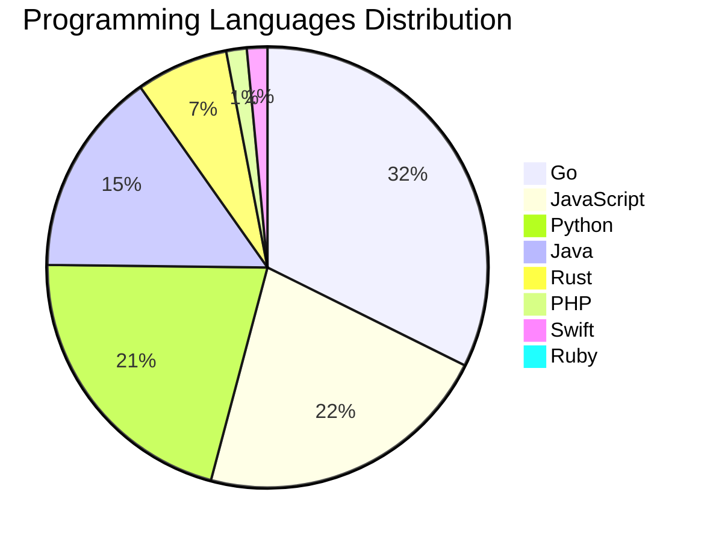

<div align="center">

# 📰 DevTech Auto News

**Your always-fresh digest of developer & AI tech news — curated automatically, around the clock.**


Aggregating [Dev.to](https://dev.to) · [Hacker News](https://news.ycombinator.com) · [GitHub Trending](https://github.com/trending) · [Lobste.rs](https://lobste.rs) · [Stack Overflow](https://stackoverflow.com) · [TechCrunch](https://techcrunch.com) · [freeCodeCamp](https://www.freecodecamp.org/news) — refreshed by GitHub Actions around the clock.

**[📰 Headlines](#-latest-headlines) · [💡 Interview Prep](#-interview-question-of-the-hour) · [📊 Statistics](#-statistics) · [⚙️ How It Works](#%EF%B8%8F-how-it-works)**

</div>

---

## 📰 Latest Headlines

> 🕐 Edition of **2026-10-22 17:00 CAT** — refreshed automatically, all day, every day.

### ✨ Featured Stories

<table>
<tr>
  <td align="center" width="33%">
    <a href="https://dev.to/pahorton/i-got-tired-of-coming-into-my-lab-to-check-the-pressure-of-my-cryocooler-so-i-built-a-tool-to-do-it-4ob7">
      
      <br/>
      <b>I Got Tired of Coming into my Lab to Check the Pre...</b>
    </a>
    <br/>
    <sub>Dev.to</sub>
  </td>
  <td align="center" width="33%">
    <a href="https://dev.to/adamthedeveloper/dont-be-a-proxy-between-me-and-your-ai-mcn">
      
      <br/>
      <b>Don't Be a Proxy Between Me and Your AI</b>
    </a>
    <br/>
    <sub>Dev.to</sub>
  </td>
  <td align="center" width="33%">
    <a href="https://dev.to/gde/building-a-cross-model-collaborative-workflow-with-google-antigravity-2jj5">
      
      <br/>
      <b>Building a Cross-Model Collaborative Workflow with...</b>
    </a>
    <br/>
    <sub>Dev.to</sub>
  </td>
</tr>
<tr>
  <td align="center" width="33%">
    <a href="https://dev.to/gde/slothsre-napops-an-overnight-gemma-4-adk-agent-that-compresses-418-lines-of-3-am-alerts-into-a-1pk6">
      
      <br/>
      <b>SlothSRE (NapOps): An Overnight Gemma 4 & ADK Agen...</b>
    </a>
    <br/>
    <sub>Dev.to</sub>
  </td>
  <td align="center" width="33%">
    <a href="https://dev.to/googlecloud/multi-tier-model-routing-on-gke-balancing-gemini-4-argon-reasoning-depth-with-latency-and-cost-21fo">
      
      <br/>
      <b>Multi-tier model routing on GKE: balancing Gemini ...</b>
    </a>
    <br/>
    <sub>Dev.to</sub>
  </td>
  <td align="center" width="33%">
    <a href="https://dev.to/georgekobaidze/promise-delivered-welcome-to-the-dev-hall-of-fame-65-authors-65-masterpieces-15fa">
      
      <br/>
      <b>Promise Delivered: Welcome to the DEV Hall of Fame...</b>
    </a>
    <br/>
    <sub>Dev.to</sub>
  </td>
</tr>
</table>


### 🗞️ Top Stories

| # | Headline | Source |
|---|----------|--------|
| 1 | [I Got Tired of Coming into my Lab to Check the Pressure of my Cryocooler so I Built a Tool to do it for Me](https://dev.to/pahorton/i-got-tired-of-coming-into-my-lab-to-check-the-pressure-of-my-cryocooler-so-i-built-a-tool-to-do-it-4ob7) | Dev.to |
| 2 | [Don't Be a Proxy Between Me and Your AI](https://dev.to/adamthedeveloper/dont-be-a-proxy-between-me-and-your-ai-mcn) | Dev.to |
| 3 | [Building a Cross-Model Collaborative Workflow with Google Antigravity](https://dev.to/gde/building-a-cross-model-collaborative-workflow-with-google-antigravity-2jj5) | Dev.to |
| 4 | [SlothSRE (NapOps): An Overnight Gemma 4 & ADK Agent That Compresses 418 Lines of 3 AM Alerts into a 2-Line Morning Digest](https://dev.to/gde/slothsre-napops-an-overnight-gemma-4-adk-agent-that-compresses-418-lines-of-3-am-alerts-into-a-1pk6) | Dev.to |
| 5 | [Multi-tier model routing on GKE: balancing Gemini 4 Argon reasoning depth with latency and cost](https://dev.to/googlecloud/multi-tier-model-routing-on-gke-balancing-gemini-4-argon-reasoning-depth-with-latency-and-cost-21fo) | Dev.to |
| 6 | [Promise Delivered: Welcome to the DEV Hall of Fame (65 Authors, 65 Masterpieces)](https://dev.to/georgekobaidze/promise-delivered-welcome-to-the-dev-hall-of-fame-65-authors-65-masterpieces-15fa) | Dev.to |
| 7 | [Natural Languages Have Design Trade-offs Too: Georgian Is Dynamically Typed, English Is Statically Typed](https://dev.to/georgekobaidze/natural-languages-have-design-trade-offs-too-georgian-is-dynamically-typed-english-is-statically-emi) | Dev.to |
| 8 | [Multi-Model Agentic Workflows: Claude Opus 5.5 & Sonnet 5.5 Land in Google Antigravity 🚀](https://dev.to/googleai/multi-model-agentic-workflows-claude-opus-55-sonnet-55-land-in-google-antigravity-2kmb) | Dev.to |
| 9 | [Automated incident triage on GKE with Gemini 4 Argon and Model Context Protocol: Correlating cluster events and VPA logs](https://dev.to/googlecloud/automated-incident-triage-on-gke-with-gemini-4-argon-and-model-context-protocol-correlating-24eb) | Dev.to |
| 10 | [Generative UI Without the Async Tax: Introducing bloc_signals_genui 1.0](https://dev.to/gde/generative-ui-without-the-async-tax-introducing-blocsignalsgenui-10-3gge) | Dev.to |
| 11 | [Building ora-tui with Google Antigravity & Gemini 4 Argon: An MS-DOS Retro TUI & OpenTelemetry Exporter for Oracle RAC, DB & SAN Multipath](https://dev.to/gde/building-ora-tui-with-google-antigravity-gemini-4-argon-an-ms-dos-retro-tui-opentelemetry-4d02) | Dev.to |
| 12 | [DuckLess: serverless DuckDB on Google Cloud, in your own project](https://dev.to/gde/duckless-serverless-duckdb-on-google-cloud-in-your-own-project-4o5a) | Dev.to |
| 13 | [Autonomous agent loops with Gemini 4 Argon and GKE Agent Sandbox: Running untrusted code safely at scale](https://dev.to/googlecloud/autonomous-agent-loops-with-gemini-4-argon-and-gke-agent-sandbox-running-untrusted-code-safely-at-2k60) | Dev.to |
| 14 | [Can a 26B MoE Run on an 8 GB GPU? Gemma 4 26B A4B on an RTX 3050](https://dev.to/gde/can-a-26b-moe-run-on-an-8-gb-gpu-gemma-4-26b-a4b-on-an-rtx-3050-2efn) | Dev.to |
| 15 | [How I Feel about the Grace Hopper Celebration Getting Cancelled](https://dev.to/jess/how-i-feel-about-the-grace-hopper-celebration-getting-cancelled-3l2k) | Dev.to |
| 16 | [Welcome Thread - v 398](https://dev.to/sloan/welcome-thread-v-398-10a6) | Dev.to |
| 17 | [Q&A with Al Chen, Software Engineering Leader at Cisco](https://dev.to/dailycontext/qa-with-al-chen-software-engineering-leader-at-cisco-jj7) | Dev.to |
| 18 | [A World Worth Understanding](https://dev.to/dailycontext/a-world-worth-understanding-f08) | Dev.to |
| 19 | [Why Smaller AI Models Can Win in the Enterprise](https://dev.to/dailycontext/why-smaller-ai-models-can-win-in-the-enterprise-1m57) | Dev.to |
| 20 | [Do Drafters Work on Small Models? Gemma 4 E2B and E4B on Two Small GPUs](https://dev.to/gde/do-drafters-work-on-small-models-gemma-4-e2b-and-e4b-on-two-small-gpus-1b4g) | Dev.to |

<sub>Last fetched: Thu, 22 Oct 2026 17:40:33 CAT</sub>


---

## 💡 Interview Question of the Hour

> Sharpen your skills — new questions selected on every update. Try answering before opening the hint!

**1. `Python` — What are generators and when would you use them?**

&nbsp;&nbsp;&nbsp;&nbsp;🎯 Medium · 🏷 iterators, memory

<details>
<summary>&nbsp;&nbsp;&nbsp;&nbsp;💡 Show hint</summary>

> yield keyword, lazy evaluation, memory efficiency

</details>

**2. `Python` — Implement a context manager using __enter__ and __exit__**

&nbsp;&nbsp;&nbsp;&nbsp;🎯 Hard · 🏷 context managers, resource management

<details>
<summary>&nbsp;&nbsp;&nbsp;&nbsp;💡 Show hint</summary>

> with statement, setup/teardown, exception handling

</details>

**3. `Database` — What is the difference between SQL and NoSQL databases?**

&nbsp;&nbsp;&nbsp;&nbsp;🎯 Easy · 🏷 databases, design

<details>
<summary>&nbsp;&nbsp;&nbsp;&nbsp;💡 Show hint</summary>

> Schema, scalability, ACID vs BASE

</details>


---

## 📊 Statistics

#### 🗂 Articles by Category

| Category | Articles | Share | |
|----------|---------:|------:|---|
| **AI** | 80 | 44.7% | `████████████████████` |
| **Tools** | 37 | 20.7% | `█████████░░░░░░░░░░░` |
| **JavaScript** | 29 | 16.2% | `███████░░░░░░░░░░░░░` |
| **Python** | 28 | 15.6% | `███████░░░░░░░░░░░░░` |
| **Security** | 21 | 11.7% | `█████░░░░░░░░░░░░░░░` |
| **DevOps** | 16 | 8.9% | `████░░░░░░░░░░░░░░░░` |
| **Cloud** | 13 | 7.3% | `███░░░░░░░░░░░░░░░░░` |
| **WebDev** | 10 | 5.6% | `███░░░░░░░░░░░░░░░░░` |
| **Mobile** | 7 | 3.9% | `██░░░░░░░░░░░░░░░░░░` |
| **Database** | 6 | 3.4% | `██░░░░░░░░░░░░░░░░░░` |

<sub>Articles can match more than one category, so shares may sum to over 100%.</sub>


#### 📡 Articles by Source

| Source | Articles |
|--------|---------:|
| Dev.to | 60 |
| HackerNews | 49 |
| GitHub | 20 |
| Lobste.rs | 10 |
| StackOverflow | 20 |
| TechCrunch | 10 |
| freeCodeCamp | 10 |


#### 💻 Programming Language Trends

```
Go              ██████████████████████████████ 31.9%
JavaScript      ████████████████████ 21.5%
Python          ███████████████████ 20.7%
Java            ██████████████ 14.8%
Rust            ██████ 6.7%
PHP             █ 1.5%
Swift           █ 1.5%
Ruby            █ 0.7%
Kotlin          █ 0.7%

```




#### 🏷 Trending Topics

            


---

## ⚙️ How It Works

This repository is a fully automated news pipeline. On every run, GitHub Actions:

1. **Fetches** the latest articles from seven sources: Dev.to, Hacker News, GitHub Trending, Lobste.rs, Stack Overflow, TechCrunch, and freeCodeCamp
2. **Deduplicates and categorizes** them across 10+ topics using keyword matching
3. **Extracts cover images** and computes language & category statistics
4. **Rebuilds this README** and appends everything to the [full archive](./data/news_log.md)
5. **Commits and pushes** the result — no human intervention needed

<details>
<summary><b>🚀 Run it yourself</b></summary>

```bash
git clone https://github.com/Derrick-MUGISHA/github-activity-bot.git
cd github-activity-bot
npm install
npm start
```

Fork the repo, enable GitHub Actions, and you have your own self-updating news feed.

</details>

<details>
<summary><b>📚 Data & resources</b></summary>

- [Full news archive](./data/news_log.md) — complete history of every fetched article
- [Statistics](./data/stats.json) — raw stats data (JSON)
- [Categorized articles](./data/categorized.json) — articles grouped by topic
- [Interview question bank](./data/interview_questions.json) — the full question set

</details>

---

## 🤝 Contributing

Ideas for new sources, categories, or interview questions are welcome — [open an issue](https://github.com/Derrick-MUGISHA/github-activity-bot/issues/new) or submit a pull request.

## 📄 License

Released under the [MIT License](https://opensource.org/licenses/MIT) — free to use, fork, and modify.

---

<div align="center">
  <sub>🤖 Last automated update: <b>Thu, 22 Oct 2026 15:40:33 GMT</b></sub><br/>
  <sub>Powered by GitHub Actions · Built with ❤️ by <a href="https://github.com/Derrick-MUGISHA">Derrick MUGISHA</a></sub>
</div>
