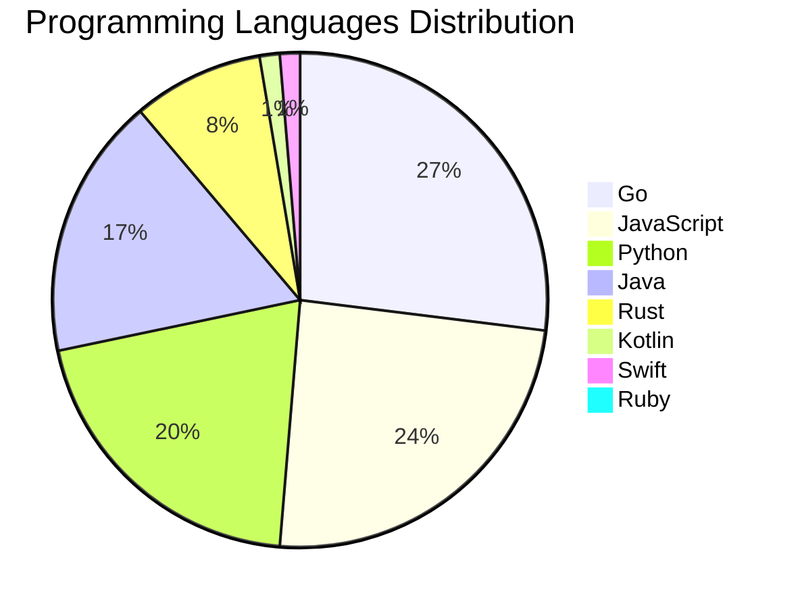

<div align="center">

# 📰 DevTech Auto News

**Your always-fresh digest of developer & AI tech news — curated automatically, around the clock.**


Aggregating [Dev.to](https://dev.to) · [Hacker News](https://news.ycombinator.com) · [GitHub Trending](https://github.com/trending) · [Lobste.rs](https://lobste.rs) · [Stack Overflow](https://stackoverflow.com) · [TechCrunch](https://techcrunch.com) · [freeCodeCamp](https://www.freecodecamp.org/news) — refreshed by GitHub Actions around the clock.

**[📰 Headlines](#-latest-headlines) · [💡 Interview Prep](#-interview-question-of-the-hour) · [📊 Statistics](#-statistics) · [⚙️ How It Works](#%EF%B8%8F-how-it-works)**

</div>

---

## 📰 Latest Headlines

> 🕐 Edition of **2026-11-12 13:00 CAT** — refreshed automatically, all day, every day.

### ✨ Featured Stories

<table>
<tr>
  <td align="center" width="33%">
    <a href="https://dev.to/maame-codes/how-did-you-end-up-in-tech-and-are-you-staying-4l9b">
      
      <br/>
      <b>How did you end up in tech, and are you staying?</b>
    </a>
    <br/>
    <sub>Dev.to</sub>
  </td>
  <td align="center" width="33%">
    <a href="https://dev.to/swyx/the-case-for-smart-software-329f">
      
      <br/>
      <b>The Case for Smart Software</b>
    </a>
    <br/>
    <sub>Dev.to</sub>
  </td>
  <td align="center" width="33%">
    <a href="https://dev.to/gde/google-ai-classroom-part-9-gamified-bingo-active-presence-verification-zero-trust-proctored-52dg">
      
      <br/>
      <b>Google AI Classroom Part 9: Gamified "Bingo" Activ...</b>
    </a>
    <br/>
    <sub>Dev.to</sub>
  </td>
</tr>
<tr>
  <td align="center" width="33%">
    <a href="https://dev.to/dailycontext/ask-more-of-your-ui-2nf7">
      
      <br/>
      <b>Ask More of Your UI</b>
    </a>
    <br/>
    <sub>Dev.to</sub>
  </td>
  <td align="center" width="33%">
    <a href="https://dev.to/googlecloud/detecting-wasmplugin-version-drift-in-cloud-load-balancing-service-extensions-52p5">
      
      <br/>
      <b>Detecting WasmPlugin version drift in Cloud Load B...</b>
    </a>
    <br/>
    <sub>Dev.to</sub>
  </td>
  <td align="center" width="33%">
    <a href="https://dev.to/googlecloud/use-your-eval-as-a-ci-gate-with-agents-cli-1ha1">
      
      <br/>
      <b>Use your eval as a CI gate with Agents CLI</b>
    </a>
    <br/>
    <sub>Dev.to</sub>
  </td>
</tr>
</table>


### 🗞️ Top Stories

| # | Headline | Source |
|---|----------|--------|
| 1 | [How did you end up in tech, and are you staying?](https://dev.to/maame-codes/how-did-you-end-up-in-tech-and-are-you-staying-4l9b) | Dev.to |
| 2 | [The Case for Smart Software](https://dev.to/swyx/the-case-for-smart-software-329f) | Dev.to |
| 3 | [Google AI Classroom Part 9: Gamified "Bingo" Active Presence Verification & Zero-Trust Proctored Exam Mode on Google Cloud](https://dev.to/gde/google-ai-classroom-part-9-gamified-bingo-active-presence-verification-zero-trust-proctored-52dg) | Dev.to |
| 4 | [Ask More of Your UI](https://dev.to/dailycontext/ask-more-of-your-ui-2nf7) | Dev.to |
| 5 | [Detecting WasmPlugin version drift in Cloud Load Balancing Service Extensions](https://dev.to/googlecloud/detecting-wasmplugin-version-drift-in-cloud-load-balancing-service-extensions-52p5) | Dev.to |
| 6 | [Use your eval as a CI gate with Agents CLI](https://dev.to/googlecloud/use-your-eval-as-a-ci-gate-with-agents-cli-1ha1) | Dev.to |
| 7 | [Software Engineering Is Becoming Factory Engineering](https://dev.to/dailycontext/software-engineering-is-becoming-factory-engineering-22ll) | Dev.to |
| 8 | [Stop Calling getGenerativeModel() Everywhere! The Hidden Traps of Scaling Firebase AI to Multi-Model Angular Apps](https://dev.to/gde/stop-calling-getgenerativemodel-everywhere-the-hidden-traps-of-scaling-firebase-ai-to-lg1) | Dev.to |
| 9 | [Google AI Classroom Part 10: Green AI FinOps, Self-Cleaning Storage Lifecycles & 1-Command Terraform IaC for Multi-School Deployment](https://dev.to/gde/google-ai-classroom-part-10-green-ai-finops-self-cleaning-storage-lifecycles-1-command-1fn) | Dev.to |
| 10 | [Google AI Classroom Part 8: AI Project Supervision — Streamlined Mobile 720p Demo, 2-Stage Diarization & Fake-Log Auditing with Gemini 4](https://dev.to/gde/google-ai-classroom-part-8-ai-project-supervision-streamlined-mobile-720p-demo-2-stage-3h98) | Dev.to |
| 11 | [Prompt Pad: What Are Open-Weight Models?](https://blog.mlh.com/prompt-pad-what-are-open-weight-models-1ghh) | Dev.to |
| 12 | [The Fastest LLM Call Is The One You Never Make](https://dev.to/dailycontext/the-fastest-llm-call-is-the-one-you-never-make-34lo) | Dev.to |
| 13 | [Kent C. Dodds Hasn't Looked at His Code All Year](https://dev.to/dailycontext/kent-c-dodds-hasnt-looked-at-his-code-all-year-gd5) | Dev.to |
| 14 | [What I Learned Managing a Full Project with Antigravity](https://dev.to/gde/what-i-learned-managing-a-full-project-with-antigravity-1ppc) | Dev.to |
| 15 | [Containing the Autonomous Mind: Sub-Second Zero-Trust Execution with GKE Agent Sandbox](https://dev.to/gde/containing-the-autonomous-mind-sub-second-zero-trust-execution-with-gke-agent-sandbox-5e6b) | Dev.to |
| 16 | [Vue.js Is My Workhorse. Now It's an Agent Skill.](https://dev.to/playfulprogramming/vuejs-is-my-workhorse-now-its-an-agent-skill-1pfk) | Dev.to |
| 17 | [Prompt Pad: Show Your AI How to Respond with Few-Shot Examples](https://blog.mlh.com/prompt-pad-show-your-ai-how-to-respond-with-few-shot-examples-2869) | Dev.to |
| 18 | [Who is building solutions with documents?](https://dev.to/missamarakay/who-is-building-solutions-for-documents-4d58) | Dev.to |
| 19 | [Congrats to the Kaggle Benchmarking Challenge Winners!](https://dev.to/devteam/congrats-to-the-kaggle-benchmarking-challenge-winners-2moh) | Dev.to |
| 20 | [Google AI Classroom Part 4: Defeating Proxy Attendance & Lab Keyloggers with WebAuthn Passkeys, Rotating HMAC QRs & GCIP Blocking Functions](https://dev.to/gde/google-ai-classroom-part-4-defeating-proxy-attendance-lab-keyloggers-with-webauthn-passkeys-2gc0) | Dev.to |

<sub>Last fetched: Thu, 12 Nov 2026 13:52:55 CAT</sub>


---

## 💡 Interview Question of the Hour

> Sharpen your skills — new questions selected on every update. Try answering before opening the hint!

**1. `SystemDesign` — Design a URL shortening service like bit.ly**

&nbsp;&nbsp;&nbsp;&nbsp;🎯 Medium · 🏷 system design, scalability

<details>
<summary>&nbsp;&nbsp;&nbsp;&nbsp;💡 Show hint</summary>

> Hash function, database design, caching, analytics

</details>

**2. `Java` — What are Java Streams and how do they work?**

&nbsp;&nbsp;&nbsp;&nbsp;🎯 Medium · 🏷 functional programming, collections

<details>
<summary>&nbsp;&nbsp;&nbsp;&nbsp;💡 Show hint</summary>

> Lazy evaluation, pipeline, terminal operations

</details>

**3. `Java` — What are Java Streams and how do they work?**

&nbsp;&nbsp;&nbsp;&nbsp;🎯 Medium · 🏷 functional programming, collections

<details>
<summary>&nbsp;&nbsp;&nbsp;&nbsp;💡 Show hint</summary>

> Lazy evaluation, pipeline, terminal operations

</details>


---

## 📊 Statistics

#### 🗂 Articles by Category

| Category | Articles | Share | |
|----------|---------:|------:|---|
| **AI** | 79 | 42.9% | `████████████████████` |
| **Tools** | 43 | 23.4% | `███████████░░░░░░░░░` |
| **JavaScript** | 37 | 20.1% | `█████████░░░░░░░░░░░` |
| **Python** | 32 | 17.4% | `████████░░░░░░░░░░░░` |
| **Security** | 19 | 10.3% | `█████░░░░░░░░░░░░░░░` |
| **DevOps** | 18 | 9.8% | `█████░░░░░░░░░░░░░░░` |
| **Cloud** | 18 | 9.8% | `█████░░░░░░░░░░░░░░░` |
| **WebDev** | 10 | 5.4% | `███░░░░░░░░░░░░░░░░░` |
| **Mobile** | 7 | 3.8% | `██░░░░░░░░░░░░░░░░░░` |
| **Database** | 2 | 1.1% | `█░░░░░░░░░░░░░░░░░░░` |

<sub>Articles can match more than one category, so shares may sum to over 100%.</sub>


#### 📡 Articles by Source

| Source | Articles |
|--------|---------:|
| Dev.to | 60 |
| HackerNews | 49 |
| GitHub | 25 |
| Lobste.rs | 10 |
| StackOverflow | 20 |
| TechCrunch | 10 |
| freeCodeCamp | 10 |


#### 💻 Programming Language Trends

```
Go              ██████████████████████████████ 26.6%
JavaScript      ███████████████████████████ 24.0%
Python          ███████████████████████ 20.1%
Java            ███████████████████ 16.9%
Rust            █████████ 8.4%
Kotlin          █ 1.3%
Swift           █ 1.3%
Ruby            █ 0.6%
CSharp          █ 0.6%

```




#### 🏷 Trending Topics

            


---

## ⚙️ How It Works

This repository is a fully automated news pipeline. On every run, GitHub Actions:

1. **Fetches** the latest articles from seven sources: Dev.to, Hacker News, GitHub Trending, Lobste.rs, Stack Overflow, TechCrunch, and freeCodeCamp
2. **Deduplicates and categorizes** them across 10+ topics using keyword matching
3. **Extracts cover images** and computes language & category statistics
4. **Rebuilds this README** and appends everything to the [full archive](./data/news_log.md)
5. **Commits and pushes** the result — no human intervention needed

<details>
<summary><b>🚀 Run it yourself</b></summary>

```bash
git clone https://github.com/Derrick-MUGISHA/github-activity-bot.git
cd github-activity-bot
npm install
npm start
```

Fork the repo, enable GitHub Actions, and you have your own self-updating news feed.

</details>

<details>
<summary><b>📚 Data & resources</b></summary>

- [Full news archive](./data/news_log.md) — complete history of every fetched article
- [Statistics](./data/stats.json) — raw stats data (JSON)
- [Categorized articles](./data/categorized.json) — articles grouped by topic
- [Interview question bank](./data/interview_questions.json) — the full question set

</details>

---

## 🤝 Contributing

Ideas for new sources, categories, or interview questions are welcome — [open an issue](https://github.com/Derrick-MUGISHA/github-activity-bot/issues/new) or submit a pull request.

## 📄 License

Released under the [MIT License](https://opensource.org/licenses/MIT) — free to use, fork, and modify.

---

<div align="center">
  <sub>🤖 Last automated update: <b>Thu, 12 Nov 2026 11:52:55 GMT</b></sub><br/>
  <sub>Powered by GitHub Actions · Built with ❤️ by <a href="https://github.com/Derrick-MUGISHA">Derrick MUGISHA</a></sub>
</div>
