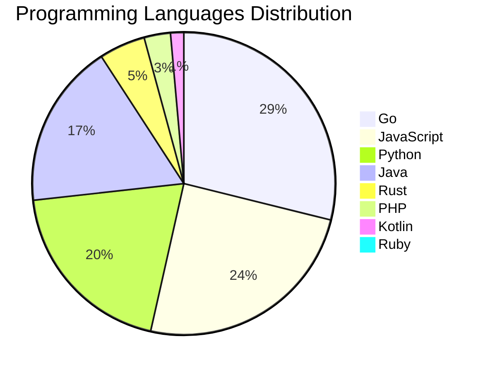

<div align="center">

# 📰 DevTech Auto News

**Your always-fresh digest of developer & AI tech news — curated automatically, around the clock.**


Aggregating [Dev.to](https://dev.to) · [Hacker News](https://news.ycombinator.com) · [GitHub Trending](https://github.com/trending) · [Lobste.rs](https://lobste.rs) · [Stack Overflow](https://stackoverflow.com) · [TechCrunch](https://techcrunch.com) · [freeCodeCamp](https://www.freecodecamp.org/news) — refreshed by GitHub Actions around the clock.

**[📰 Headlines](#-latest-headlines) · [💡 Interview Prep](#-interview-question-of-the-hour) · [📊 Statistics](#-statistics) · [⚙️ How It Works](#%EF%B8%8F-how-it-works)**

</div>

---

## 📰 Latest Headlines

> 🕐 Edition of **2026-10-27 8:00 CAT** — refreshed automatically, all day, every day.

### ✨ Featured Stories

<table>
<tr>
  <td align="center" width="33%">
    <a href="https://dev.to/devteam/join-the-hacktoberfest-open-source-ai-challenge-ghost-in-the-machine-2850-in-prizes-across-21-3cho">
      
      <br/>
      <b>Join the Hacktoberfest Open-Source AI Challenge: G...</b>
    </a>
    <br/>
    <sub>Dev.to</sub>
  </td>
  <td align="center" width="33%">
    <a href="https://dev.to/gde/why-blocadd-isnt-what-you-think-synchronous-event-fast-paths-and-0ms-form-bindings-6o">
      
      <br/>
      <b>Why bloc.add(...) Isn't What You Think: Synchronou...</b>
    </a>
    <br/>
    <sub>Dev.to</sub>
  </td>
  <td align="center" width="33%">
    <a href="https://dev.to/khushighosh/let-it-die-the-lazy-email-agent-on-tabpfn-gemma-and-temporal-10o0">
      
      <br/>
      <b>Let It Die: The Lazy Email Agent on TabPFN, Gemma ...</b>
    </a>
    <br/>
    <sub>Dev.to</sub>
  </td>
</tr>
<tr>
  <td align="center" width="33%">
    <a href="https://dev.to/ben/meme-monday-18k">
      
      <br/>
      <b>Meme Monday</b>
    </a>
    <br/>
    <sub>Dev.to</sub>
  </td>
  <td align="center" width="33%">
    <a href="https://dev.to/hemapriya_kanagala/dev-pet-corner-3-show-us-your-pets-35n">
      
      <br/>
      <b>🐾 DEV Pet Corner #3: Show Us Your Pets!</b>
    </a>
    <br/>
    <sub>Dev.to</sub>
  </td>
  <td align="center" width="33%">
    <a href="https://dev.to/gde/inference-on-google-cloud-precision-memory-and-capacity-on-tpu-from-v5e-to-ironwood-5dlf">
      
      <br/>
      <b>Inference on Google Cloud: Precision, Memory and C...</b>
    </a>
    <br/>
    <sub>Dev.to</sub>
  </td>
</tr>
</table>


### 🗞️ Top Stories

| # | Headline | Source |
|---|----------|--------|
| 1 | [Join the Hacktoberfest Open-Source AI Challenge: Ghost in the Machine! $2,850 in Prizes Across 21 Winners.](https://dev.to/devteam/join-the-hacktoberfest-open-source-ai-challenge-ghost-in-the-machine-2850-in-prizes-across-21-3cho) | Dev.to |
| 2 | [Why bloc.add(...) Isn't What You Think: Synchronous Event Fast-Paths and 0ms Form Bindings](https://dev.to/gde/why-blocadd-isnt-what-you-think-synchronous-event-fast-paths-and-0ms-form-bindings-6o) | Dev.to |
| 3 | [Let It Die: The Lazy Email Agent on TabPFN, Gemma and Temporal](https://dev.to/khushighosh/let-it-die-the-lazy-email-agent-on-tabpfn-gemma-and-temporal-10o0) | Dev.to |
| 4 | [Meme Monday](https://dev.to/ben/meme-monday-18k) | Dev.to |
| 5 | [🐾 DEV Pet Corner #3: Show Us Your Pets!](https://dev.to/hemapriya_kanagala/dev-pet-corner-3-show-us-your-pets-35n) | Dev.to |
| 6 | [Inference on Google Cloud: Precision, Memory and Capacity on TPU, from v5e to Ironwood](https://dev.to/gde/inference-on-google-cloud-precision-memory-and-capacity-on-tpu-from-v5e-to-ironwood-5dlf) | Dev.to |
| 7 | [Don't Be a Proxy Between Me and Your AI](https://dev.to/adamthedeveloper/dont-be-a-proxy-between-me-and-your-ai-mcn) | Dev.to |
| 8 | [926 Steps, Two Lobotomies, and Zero Nudges: Flight-Testing the Commitment Machine Across Gemini, Claude, and GPT-OSS](https://dev.to/gde/926-steps-two-lobotomies-and-zero-nudges-flight-testing-the-commitment-machine-across-gemini-55ca) | Dev.to |
| 9 | [Promise Delivered: Welcome to the DEV Hall of Fame (65 Authors, 65 Masterpieces)](https://dev.to/georgekobaidze/promise-delivered-welcome-to-the-dev-hall-of-fame-65-authors-65-masterpieces-15fa) | Dev.to |
| 10 | [Postmortem: The Tuesday Our AI Bill Had No Owner](https://dev.to/gde/postmortem-the-tuesday-our-ai-bill-had-no-owner-34pd) | Dev.to |
| 11 | [Automated incident triage on GKE with Gemini 4 Argon and Model Context Protocol: Correlating cluster events and VPA logs](https://dev.to/googlecloud/automated-incident-triage-on-gke-with-gemini-4-argon-and-model-context-protocol-correlating-24eb) | Dev.to |
| 12 | [Generative UI Without the Async Tax: Introducing bloc_signals_genui 1.0](https://dev.to/gde/generative-ui-without-the-async-tax-introducing-blocsignalsgenui-10-3gge) | Dev.to |
| 13 | [Natural Languages Have Design Trade-offs Too: Georgian Is Dynamically Typed, English Is Statically Typed](https://dev.to/georgekobaidze/natural-languages-have-design-trade-offs-too-georgian-is-dynamically-typed-english-is-statically-emi) | Dev.to |
| 14 | [The Best Prompt Rule Is the One You Delete: Moving AI Guardrails Out of Markdown and Into Git Locks, Linux insmod, and 15ms Compiler Auto-Fixes](https://dev.to/gde/the-best-prompt-rule-is-the-one-you-delete-moving-ai-guardrails-out-of-markdown-and-into-git-5a5h) | Dev.to |
| 15 | [Trick, Treat, and Code: Highlighting GDGC VTU's Best Halloween Hacks 🕸️💻](https://dev.to/gdg/trick-treat-and-code-highlighting-gdgc-vtus-best-halloween-hacks-4hpf) | Dev.to |
| 16 | [Building ora-tui with Google Antigravity & Gemini 4 Argon: An MS-DOS Retro TUI & OpenTelemetry Exporter for Oracle RAC, DB & SAN Multipath](https://dev.to/gde/building-ora-tui-with-google-antigravity-gemini-4-argon-an-ms-dos-retro-tui-opentelemetry-4d02) | Dev.to |
| 17 | [[Agent Platform in Action (6)] Towards Production-Grade AI Agent Ops: Building Full-Stack Observable LINE Agents with agents-cli](https://dev.to/gde/agent-platform-in-action-6-towards-production-grade-ai-agent-ops-building-full-stack-38aa) | Dev.to |
| 18 | [DuckLess: serverless DuckDB on Google Cloud, in your own project](https://dev.to/gde/duckless-serverless-duckdb-on-google-cloud-in-your-own-project-4o5a) | Dev.to |
| 19 | [GPT-6 Is Coming to Google Cloud. Is Your AI Bill Ready?](https://dev.to/gde/gpt-6-is-coming-to-google-cloud-is-your-ai-bill-ready-j7l) | Dev.to |
| 20 | [Autonomous agent loops with Gemini 4 Argon and GKE Agent Sandbox: Running untrusted code safely at scale](https://dev.to/googlecloud/autonomous-agent-loops-with-gemini-4-argon-and-gke-agent-sandbox-running-untrusted-code-safely-at-2k60) | Dev.to |

<sub>Last fetched: Tue, 27 Oct 2026 08:08:46 CAT</sub>


---

## 💡 Interview Question of the Hour

> Sharpen your skills — new questions selected on every update. Try answering before opening the hint!

**1. `Database` — What is database normalization and denormalization?**

&nbsp;&nbsp;&nbsp;&nbsp;🎯 Medium · 🏷 design, optimization

<details>
<summary>&nbsp;&nbsp;&nbsp;&nbsp;💡 Show hint</summary>

> Normal forms, redundancy, performance trade-offs

</details>

**2. `Python` — Explain decorators in Python with an example**

&nbsp;&nbsp;&nbsp;&nbsp;🎯 Medium · 🏷 functions, metaprogramming

<details>
<summary>&nbsp;&nbsp;&nbsp;&nbsp;💡 Show hint</summary>

> Function wrappers, @syntax, practical uses

</details>

**3. `Database` — Design a database schema for a social media platform**

&nbsp;&nbsp;&nbsp;&nbsp;🎯 Hard · 🏷 design, scalability

<details>
<summary>&nbsp;&nbsp;&nbsp;&nbsp;💡 Show hint</summary>

> Users, posts, relationships, indexes, partitioning

</details>


---

## 📊 Statistics

#### 🗂 Articles by Category

| Category | Articles | Share | |
|----------|---------:|------:|---|
| **AI** | 81 | 44.3% | `████████████████████` |
| **Tools** | 40 | 21.9% | `██████████░░░░░░░░░░` |
| **JavaScript** | 35 | 19.1% | `█████████░░░░░░░░░░░` |
| **Python** | 28 | 15.3% | `███████░░░░░░░░░░░░░` |
| **Cloud** | 17 | 9.3% | `████░░░░░░░░░░░░░░░░` |
| **DevOps** | 16 | 8.7% | `████░░░░░░░░░░░░░░░░` |
| **Security** | 15 | 8.2% | `████░░░░░░░░░░░░░░░░` |
| **WebDev** | 10 | 5.5% | `██░░░░░░░░░░░░░░░░░░` |
| **Database** | 8 | 4.4% | `██░░░░░░░░░░░░░░░░░░` |
| **Mobile** | 5 | 2.7% | `█░░░░░░░░░░░░░░░░░░░` |

<sub>Articles can match more than one category, so shares may sum to over 100%.</sub>


#### 📡 Articles by Source

| Source | Articles |
|--------|---------:|
| Dev.to | 59 |
| HackerNews | 49 |
| GitHub | 25 |
| Lobste.rs | 10 |
| StackOverflow | 20 |
| TechCrunch | 10 |
| freeCodeCamp | 10 |


#### 💻 Programming Language Trends

```
Go              ██████████████████████████████ 28.7%
JavaScript      ██████████████████████████ 24.5%
Python          ████████████████████ 19.6%
Java            ██████████████████ 17.5%
Rust            █████ 4.9%
PHP             ███ 2.8%
Kotlin          █ 1.4%
Ruby            █ 0.7%

```




#### 🏷 Trending Topics

            


---

## ⚙️ How It Works

This repository is a fully automated news pipeline. On every run, GitHub Actions:

1. **Fetches** the latest articles from seven sources: Dev.to, Hacker News, GitHub Trending, Lobste.rs, Stack Overflow, TechCrunch, and freeCodeCamp
2. **Deduplicates and categorizes** them across 10+ topics using keyword matching
3. **Extracts cover images** and computes language & category statistics
4. **Rebuilds this README** and appends everything to the [full archive](./data/news_log.md)
5. **Commits and pushes** the result — no human intervention needed

<details>
<summary><b>🚀 Run it yourself</b></summary>

```bash
git clone https://github.com/Derrick-MUGISHA/github-activity-bot.git
cd github-activity-bot
npm install
npm start
```

Fork the repo, enable GitHub Actions, and you have your own self-updating news feed.

</details>

<details>
<summary><b>📚 Data & resources</b></summary>

- [Full news archive](./data/news_log.md) — complete history of every fetched article
- [Statistics](./data/stats.json) — raw stats data (JSON)
- [Categorized articles](./data/categorized.json) — articles grouped by topic
- [Interview question bank](./data/interview_questions.json) — the full question set

</details>

---

## 🤝 Contributing

Ideas for new sources, categories, or interview questions are welcome — [open an issue](https://github.com/Derrick-MUGISHA/github-activity-bot/issues/new) or submit a pull request.

## 📄 License

Released under the [MIT License](https://opensource.org/licenses/MIT) — free to use, fork, and modify.

---

<div align="center">
  <sub>🤖 Last automated update: <b>Tue, 27 Oct 2026 06:08:46 GMT</b></sub><br/>
  <sub>Powered by GitHub Actions · Built with ❤️ by <a href="https://github.com/Derrick-MUGISHA">Derrick MUGISHA</a></sub>
</div>
