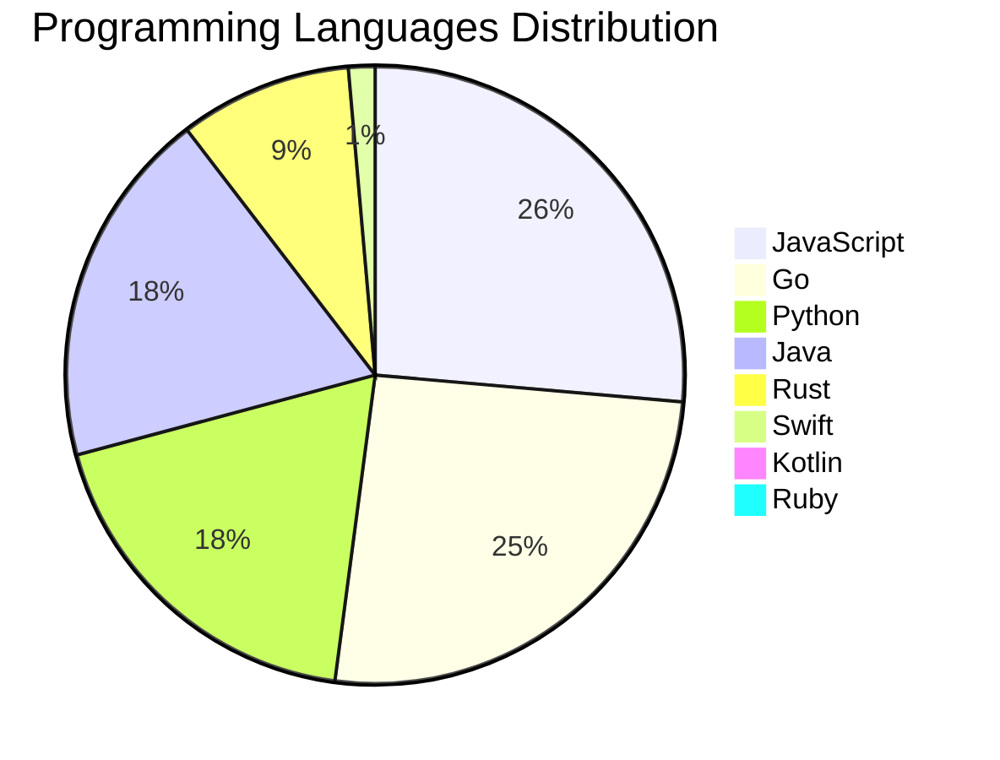

<div align="center">

# 📰 DevTech Auto News

**Your always-fresh digest of developer & AI tech news — curated automatically, around the clock.**


Aggregating [Dev.to](https://dev.to) · [Hacker News](https://news.ycombinator.com) · [GitHub Trending](https://github.com/trending) · [Lobste.rs](https://lobste.rs) · [Stack Overflow](https://stackoverflow.com) · [TechCrunch](https://techcrunch.com) · [freeCodeCamp](https://www.freecodecamp.org/news) — refreshed by GitHub Actions around the clock.

**[📰 Headlines](#-latest-headlines) · [💡 Interview Prep](#-interview-question-of-the-hour) · [📊 Statistics](#-statistics) · [⚙️ How It Works](#%EF%B8%8F-how-it-works)**

</div>

---

## 📰 Latest Headlines

> 🕐 Edition of **2026-11-08 11:00 CAT** — refreshed automatically, all day, every day.

### ✨ Featured Stories

<table>
<tr>
  <td align="center" width="33%">
    <a href="https://dev.to/devteam/what-was-your-win-this-week-28dh">
      
      <br/>
      <b>What was your win this week?</b>
    </a>
    <br/>
    <sub>Dev.to</sub>
  </td>
  <td align="center" width="33%">
    <a href="https://dev.to/devteam/congrats-to-the-kaggle-benchmarking-challenge-winners-2moh">
      
      <br/>
      <b>Congrats to the Kaggle Benchmarking Challenge Winn...</b>
    </a>
    <br/>
    <sub>Dev.to</sub>
  </td>
  <td align="center" width="33%">
    <a href="https://dev.to/gde/android-17-on-a-49-kernel-lineageos-240-on-the-pixel-3a-1mok">
      
      <br/>
      <b>Android 17 on a 4.9 Kernel: LineageOS 24.0 on the ...</b>
    </a>
    <br/>
    <sub>Dev.to</sub>
  </td>
</tr>
<tr>
  <td align="center" width="33%">
    <a href="https://dev.to/gde/crows-moths-and-makefiles-how-300-megabytes-of-crow-dna-explains-why-a-20-kilobyte-scar-file-36a">
      
      <br/>
      <b>Crows, Moths, and Makefiles: How 300 Megabytes of ...</b>
    </a>
    <br/>
    <sub>Dev.to</sub>
  </td>
  <td align="center" width="33%">
    <a href="https://blog.mlh.com/prompt-pad-what-are-open-weight-models-1ghh">
      
      <br/>
      <b>Prompt Pad: What Are Open-Weight Models?</b>
    </a>
    <br/>
    <sub>Dev.to</sub>
  </td>
  <td align="center" width="33%">
    <a href="https://dev.to/gde/leveling-the-playing-field-building-a-100-offline-kubernetes-docs-rag-exam-assistant-with-web-ai-53bi">
      
      <br/>
      <b>Leveling the Playing Field: Building a 100% Offlin...</b>
    </a>
    <br/>
    <sub>Dev.to</sub>
  </td>
</tr>
</table>


### 🗞️ Top Stories

| # | Headline | Source |
|---|----------|--------|
| 1 | [What was your win this week?](https://dev.to/devteam/what-was-your-win-this-week-28dh) | Dev.to |
| 2 | [Congrats to the Kaggle Benchmarking Challenge Winners!](https://dev.to/devteam/congrats-to-the-kaggle-benchmarking-challenge-winners-2moh) | Dev.to |
| 3 | [Android 17 on a 4.9 Kernel: LineageOS 24.0 on the Pixel 3a](https://dev.to/gde/android-17-on-a-49-kernel-lineageos-240-on-the-pixel-3a-1mok) | Dev.to |
| 4 | [Crows, Moths, and Makefiles: How 300 Megabytes of Crow DNA Explains Why a 20-Kilobyte Scar File Outsmarts a Terabyte LLM](https://dev.to/gde/crows-moths-and-makefiles-how-300-megabytes-of-crow-dna-explains-why-a-20-kilobyte-scar-file-36a) | Dev.to |
| 5 | [Prompt Pad: What Are Open-Weight Models?](https://blog.mlh.com/prompt-pad-what-are-open-weight-models-1ghh) | Dev.to |
| 6 | [Leveling the Playing Field: Building a 100% Offline Kubernetes Docs RAG Exam Assistant with Web AI, Gemma 4, and WebGPU](https://dev.to/gde/leveling-the-playing-field-building-a-100-offline-kubernetes-docs-rag-exam-assistant-with-web-ai-53bi) | Dev.to |
| 7 | [What I Learned Managing a Full Project with Antigravity](https://dev.to/gde/what-i-learned-managing-a-full-project-with-antigravity-1ppc) | Dev.to |
| 8 | [Thank you to everyone who pointed out the phishing posts we got yesterday. We're working on improved mechanisms to automatically reject those types of attacks.](https://dev.to/ben/thank-you-to-everyone-who-pointed-out-the-phishing-posts-we-got-yesterday-were-working-on-1h9b) | Dev.to |
| 9 | [Containing the Autonomous Mind: Sub-Second Zero-Trust Execution with GKE Agent Sandbox](https://dev.to/gde/containing-the-autonomous-mind-sub-second-zero-trust-execution-with-gke-agent-sandbox-5e6b) | Dev.to |
| 10 | [Prompt Pad: Show Your AI How to Respond with Few-Shot Examples](https://blog.mlh.com/prompt-pad-show-your-ai-how-to-respond-with-few-shot-examples-2869) | Dev.to |
| 11 | [Who is building solutions with documents?](https://dev.to/missamarakay/who-is-building-solutions-for-documents-4d58) | Dev.to |
| 12 | [Find the production agent failures that every health check misses](https://dev.to/googlecloud/find-the-production-agent-failures-that-every-health-check-misses-39j8) | Dev.to |
| 13 | [Securing an Angular Firebase AI App with Email/Password Authentication (Part 2: Signal Forms Sign-In Modal) [GDE]](https://dev.to/gde/securing-an-angular-firebase-ai-app-with-emailpassword-authentication-part-2-signal-forms-3ll9) | Dev.to |
| 14 | [Prompt Pad: Lock Your AI's Output Schema in Google AI Studio](https://blog.mlh.com/prompt-pad-lock-your-ais-output-schema-in-google-ai-studio-53io) | Dev.to |
| 15 | [One Word, Two GPUs: Why Gemma 4 Answers the Same Question Differently on a Laptop and a Tesla T4](https://dev.to/gde/one-word-two-gpus-why-gemma-4-answers-the-same-question-differently-on-a-laptop-and-a-tesla-t4-1dj2) | Dev.to |
| 16 | [That's a Wrap on Hacktoberfest 2026! 🎃👻](https://dev.to/devteam/thats-a-wrap-on-hacktoberfest-2026-148k) | Dev.to |
| 17 | [Gemma 4 in Rust on TorchTPU: Hands On With Colab](https://dev.to/gde/gemma-4-in-rust-on-torchtpu-hands-on-with-colab-44hi) | Dev.to |
| 18 | [Let's see where you code!](https://dev.to/maame-codes/lets-see-where-you-code-147) | Dev.to |
| 19 | [[Agent Platform in Action (7)] When ADK Go Graph Workflow Meets Google Research Harness (Part 1): Two-Layer Recursive Agent Fram](https://dev.to/gde/agent-platform-in-action-7-when-adk-go-graph-workflow-meets-google-research-harness-part-1-28c1) | Dev.to |
| 20 | [Profile Sprawl: Solving a Problem You Didn't Know You Had](https://dev.to/gde/profile-sprawl-solving-a-problem-you-didnt-know-you-had-19k5) | Dev.to |

<sub>Last fetched: Sun, 08 Nov 2026 11:37:58 CAT</sub>


---

## 💡 Interview Question of the Hour

> Sharpen your skills — new questions selected on every update. Try answering before opening the hint!

**1. `Java` — What is the difference between abstract class and interface?**

&nbsp;&nbsp;&nbsp;&nbsp;🎯 Easy · 🏷 OOP, design

<details>
<summary>&nbsp;&nbsp;&nbsp;&nbsp;💡 Show hint</summary>

> Multiple inheritance, method implementation, use cases

</details>

**2. `SystemDesign` — Design a distributed cache system**

&nbsp;&nbsp;&nbsp;&nbsp;🎯 Hard · 🏷 distributed systems, caching

<details>
<summary>&nbsp;&nbsp;&nbsp;&nbsp;💡 Show hint</summary>

> Consistency, partitioning, replication, eviction policies

</details>

**3. `NodeJS` — How do you handle errors in async/await?**

&nbsp;&nbsp;&nbsp;&nbsp;🎯 Medium · 🏷 error handling, async

<details>
<summary>&nbsp;&nbsp;&nbsp;&nbsp;💡 Show hint</summary>

> try/catch, .catch(), error middleware

</details>


---

## 📊 Statistics

#### 🗂 Articles by Category

| Category | Articles | Share | |
|----------|---------:|------:|---|
| **AI** | 76 | 41.3% | `████████████████████` |
| **JavaScript** | 38 | 20.7% | `██████████░░░░░░░░░░` |
| **Tools** | 38 | 20.7% | `██████████░░░░░░░░░░` |
| **Python** | 28 | 15.2% | `███████░░░░░░░░░░░░░` |
| **Security** | 22 | 12.0% | `██████░░░░░░░░░░░░░░` |
| **DevOps** | 18 | 9.8% | `█████░░░░░░░░░░░░░░░` |
| **Cloud** | 10 | 5.4% | `███░░░░░░░░░░░░░░░░░` |
| **WebDev** | 9 | 4.9% | `██░░░░░░░░░░░░░░░░░░` |
| **Mobile** | 8 | 4.3% | `██░░░░░░░░░░░░░░░░░░` |
| **Database** | 4 | 2.2% | `█░░░░░░░░░░░░░░░░░░░` |

<sub>Articles can match more than one category, so shares may sum to over 100%.</sub>


#### 📡 Articles by Source

| Source | Articles |
|--------|---------:|
| Dev.to | 60 |
| HackerNews | 49 |
| GitHub | 25 |
| Lobste.rs | 10 |
| StackOverflow | 20 |
| TechCrunch | 10 |
| freeCodeCamp | 10 |


#### 💻 Programming Language Trends

```
JavaScript      ██████████████████████████████ 26.0%
Go              █████████████████████████████ 25.3%
Python          █████████████████████ 18.5%
Java            █████████████████████ 18.5%
Rust            ██████████ 8.9%
Swift           ██ 1.4%
Kotlin          █ 0.7%
Ruby            █ 0.7%

```




#### 🏷 Trending Topics

            


---

## ⚙️ How It Works

This repository is a fully automated news pipeline. On every run, GitHub Actions:

1. **Fetches** the latest articles from seven sources: Dev.to, Hacker News, GitHub Trending, Lobste.rs, Stack Overflow, TechCrunch, and freeCodeCamp
2. **Deduplicates and categorizes** them across 10+ topics using keyword matching
3. **Extracts cover images** and computes language & category statistics
4. **Rebuilds this README** and appends everything to the [full archive](./data/news_log.md)
5. **Commits and pushes** the result — no human intervention needed

<details>
<summary><b>🚀 Run it yourself</b></summary>

```bash
git clone https://github.com/Derrick-MUGISHA/github-activity-bot.git
cd github-activity-bot
npm install
npm start
```

Fork the repo, enable GitHub Actions, and you have your own self-updating news feed.

</details>

<details>
<summary><b>📚 Data & resources</b></summary>

- [Full news archive](./data/news_log.md) — complete history of every fetched article
- [Statistics](./data/stats.json) — raw stats data (JSON)
- [Categorized articles](./data/categorized.json) — articles grouped by topic
- [Interview question bank](./data/interview_questions.json) — the full question set

</details>

---

## 🤝 Contributing

Ideas for new sources, categories, or interview questions are welcome — [open an issue](https://github.com/Derrick-MUGISHA/github-activity-bot/issues/new) or submit a pull request.

## 📄 License

Released under the [MIT License](https://opensource.org/licenses/MIT) — free to use, fork, and modify.

---

<div align="center">
  <sub>🤖 Last automated update: <b>Sun, 08 Nov 2026 09:37:58 GMT</b></sub><br/>
  <sub>Powered by GitHub Actions · Built with ❤️ by <a href="https://github.com/Derrick-MUGISHA">Derrick MUGISHA</a></sub>
</div>
