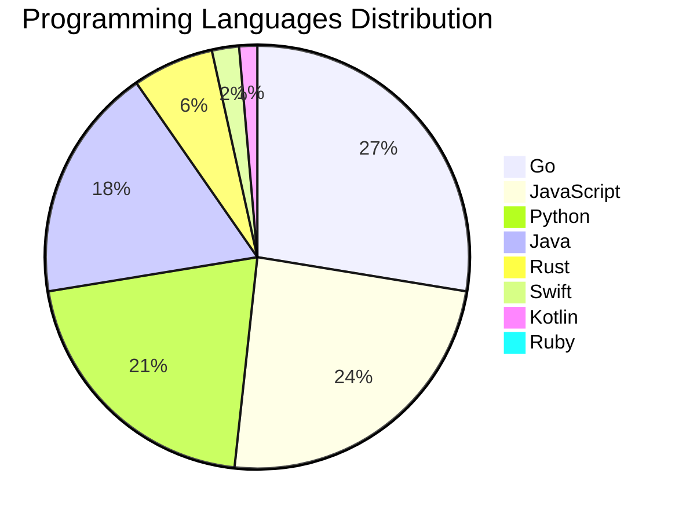

<div align="center">

# 📰 DevTech Auto News

**Your always-fresh digest of developer & AI tech news — curated automatically, around the clock.**


Aggregating [Dev.to](https://dev.to) · [Hacker News](https://news.ycombinator.com) · [GitHub Trending](https://github.com/trending) · [Lobste.rs](https://lobste.rs) · [Stack Overflow](https://stackoverflow.com) · [TechCrunch](https://techcrunch.com) · [freeCodeCamp](https://www.freecodecamp.org/news) — refreshed by GitHub Actions around the clock.

**[📰 Headlines](#-latest-headlines) · [💡 Interview Prep](#-interview-question-of-the-hour) · [📊 Statistics](#-statistics) · [⚙️ How It Works](#%EF%B8%8F-how-it-works)**

</div>

---

## 📰 Latest Headlines

> 🕐 Edition of **2026-10-20 19:00 CAT** — refreshed automatically, all day, every day.

### ✨ Featured Stories

<table>
<tr>
  <td align="center" width="33%">
    <a href="https://dev.to/georgekobaidze/promise-delivered-welcome-to-the-dev-hall-of-fame-65-authors-65-masterpieces-15fa">
      
      <br/>
      <b>Promise Delivered: Welcome to the DEV Hall of Fame...</b>
    </a>
    <br/>
    <sub>Dev.to</sub>
  </td>
  <td align="center" width="33%">
    <a href="https://dev.to/gde/stress-testing-gemini-4-argon-building-a-3d-flutter-kart-game-in-15-prompts-with-zero-assets-55ha">
      
      <br/>
      <b>Stress-Testing Gemini 4 Argon: Building a 3D Flutt...</b>
    </a>
    <br/>
    <sub>Dev.to</sub>
  </td>
  <td align="center" width="33%">
    <a href="https://dev.to/devteam/top-7-featured-dev-posts-of-the-week-13ii">
      
      <br/>
      <b>Top 7 Featured DEV Posts of the Week</b>
    </a>
    <br/>
    <sub>Dev.to</sub>
  </td>
</tr>
<tr>
  <td align="center" width="33%">
    <a href="https://dev.to/gde/can-a-26b-moe-run-on-an-8-gb-gpu-gemma-4-26b-a4b-on-an-rtx-3050-2efn">
      
      <br/>
      <b>Can a 26B MoE Run on an 8 GB GPU? Gemma 4 26B A4B ...</b>
    </a>
    <br/>
    <sub>Dev.to</sub>
  </td>
  <td align="center" width="33%">
    <a href="https://dev.to/devteam/join-the-hacktoberfest-open-source-ai-challenge-slow-and-steady-2850-in-prizes-across-21-3iee">
      
      <br/>
      <b>Join the Hacktoberfest Open-Source AI Challenge: S...</b>
    </a>
    <br/>
    <sub>Dev.to</sub>
  </td>
  <td align="center" width="33%">
    <a href="https://dev.to/georgekobaidze/natural-languages-have-design-trade-offs-too-georgian-is-dynamically-typed-english-is-statically-emi">
      
      <br/>
      <b>Natural Languages Have Design Trade-offs Too: Geor...</b>
    </a>
    <br/>
    <sub>Dev.to</sub>
  </td>
</tr>
</table>


### 🗞️ Top Stories

| # | Headline | Source |
|---|----------|--------|
| 1 | [Promise Delivered: Welcome to the DEV Hall of Fame (65 Authors, 65 Masterpieces)](https://dev.to/georgekobaidze/promise-delivered-welcome-to-the-dev-hall-of-fame-65-authors-65-masterpieces-15fa) | Dev.to |
| 2 | [Stress-Testing Gemini 4 Argon: Building a 3D Flutter Kart Game in 15 Prompts with Zero Assets](https://dev.to/gde/stress-testing-gemini-4-argon-building-a-3d-flutter-kart-game-in-15-prompts-with-zero-assets-55ha) | Dev.to |
| 3 | [Top 7 Featured DEV Posts of the Week](https://dev.to/devteam/top-7-featured-dev-posts-of-the-week-13ii) | Dev.to |
| 4 | [Can a 26B MoE Run on an 8 GB GPU? Gemma 4 26B A4B on an RTX 3050](https://dev.to/gde/can-a-26b-moe-run-on-an-8-gb-gpu-gemma-4-26b-a4b-on-an-rtx-3050-2efn) | Dev.to |
| 5 | [Join the Hacktoberfest Open-Source AI Challenge: Slow and Steady! $2,850 in Prizes Across 21 Winners.](https://dev.to/devteam/join-the-hacktoberfest-open-source-ai-challenge-slow-and-steady-2850-in-prizes-across-21-3iee) | Dev.to |
| 6 | [Natural Languages Have Design Trade-offs Too: Georgian Is Dynamically Typed, English Is Statically Typed](https://dev.to/georgekobaidze/natural-languages-have-design-trade-offs-too-georgian-is-dynamically-typed-english-is-statically-emi) | Dev.to |
| 7 | [Dev Opportunity Radar #21: $500K Y Combinator Funding, Bolt Builders Week, and AI Safety Research Residency](https://dev.to/devengers/dev-opportunity-radar-21-500k-y-combinator-funding-bolt-builders-week-and-ai-safety-research-12b8) | Dev.to |
| 8 | [Building ora-tui with Google Antigravity & Gemini 4 Argon: An MS-DOS Retro TUI & OpenTelemetry Exporter for Oracle RAC, DB & SAN Multipath](https://dev.to/gde/building-ora-tui-with-google-antigravity-gemini-4-argon-an-ms-dos-retro-tui-opentelemetry-4d02) | Dev.to |
| 9 | [DuckLess: serverless DuckDB on Google Cloud, in your own project](https://dev.to/gde/duckless-serverless-duckdb-on-google-cloud-in-your-own-project-4o5a) | Dev.to |
| 10 | [Autonomous agent loops with Gemini 4 Argon and GKE Agent Sandbox: Running untrusted code safely at scale](https://dev.to/googlecloud/autonomous-agent-loops-with-gemini-4-argon-and-gke-agent-sandbox-running-untrusted-code-safely-at-2k60) | Dev.to |
| 11 | [Don't Assume Your Cloud T4 Runs at Spec: Gemma 4 Decode Falls 7% as the Card Warms](https://dev.to/gde/dont-assume-your-cloud-t4-runs-at-spec-gemma-4-decode-falls-7-as-the-card-warms-3fd3) | Dev.to |
| 12 | [How I Feel about the Grace Hopper Celebration Getting Cancelled](https://dev.to/jess/how-i-feel-about-the-grace-hopper-celebration-getting-cancelled-3l2k) | Dev.to |
| 13 | [Q&A with Al Chen, Software Engineering Leader at Cisco](https://dev.to/dailycontext/qa-with-al-chen-software-engineering-leader-at-cisco-jj7) | Dev.to |
| 14 | [Why Smaller AI Models Can Win in the Enterprise](https://dev.to/dailycontext/why-smaller-ai-models-can-win-in-the-enterprise-1m57) | Dev.to |
| 15 | [A World Worth Understanding](https://dev.to/dailycontext/a-world-worth-understanding-f08) | Dev.to |
| 16 | [💅 Keyboard Makeover](https://dev.to/annavi11arrea1/keyboard-makeover-i6a) | Dev.to |
| 17 | [Do Drafters Work on Small Models? Gemma 4 E2B and E4B on Two Small GPUs](https://dev.to/gde/do-drafters-work-on-small-models-gemma-4-e2b-and-e4b-on-two-small-gpus-1b4g) | Dev.to |
| 18 | [Meme Monday](https://dev.to/ben/meme-monday-2hle) | Dev.to |
| 19 | [🌑 Blue October](https://dev.to/annavi11arrea1/blue-october-1jia) | Dev.to |
| 20 | [Comparing Qwen and Gemma on the Low End: Qwen Is Faster Without Drafting, Gemma Has Better Quality](https://dev.to/gde/comparing-qwen-and-gemma-on-the-low-end-qwen-is-faster-without-drafting-gemma-has-better-quality-30bo) | Dev.to |

<sub>Last fetched: Tue, 20 Oct 2026 19:58:41 CAT</sub>


---

## 💡 Interview Question of the Hour

> Sharpen your skills — new questions selected on every update. Try answering before opening the hint!

**1. `Java` — What are Java Streams and how do they work?**

&nbsp;&nbsp;&nbsp;&nbsp;🎯 Medium · 🏷 functional programming, collections

<details>
<summary>&nbsp;&nbsp;&nbsp;&nbsp;💡 Show hint</summary>

> Lazy evaluation, pipeline, terminal operations

</details>

**2. `SystemDesign` — Design a URL shortening service like bit.ly**

&nbsp;&nbsp;&nbsp;&nbsp;🎯 Medium · 🏷 system design, scalability

<details>
<summary>&nbsp;&nbsp;&nbsp;&nbsp;💡 Show hint</summary>

> Hash function, database design, caching, analytics

</details>

**3. `Python` — What is the difference between list and tuple in Python?**

&nbsp;&nbsp;&nbsp;&nbsp;🎯 Easy · 🏷 data structures, mutability

<details>
<summary>&nbsp;&nbsp;&nbsp;&nbsp;💡 Show hint</summary>

> Mutability, performance, use cases

</details>


---

## 📊 Statistics

#### 🗂 Articles by Category

| Category | Articles | Share | |
|----------|---------:|------:|---|
| **AI** | 85 | 46.2% | `████████████████████` |
| **Tools** | 43 | 23.4% | `██████████░░░░░░░░░░` |
| **JavaScript** | 35 | 19.0% | `████████░░░░░░░░░░░░` |
| **Python** | 30 | 16.3% | `███████░░░░░░░░░░░░░` |
| **Security** | 18 | 9.8% | `████░░░░░░░░░░░░░░░░` |
| **DevOps** | 17 | 9.2% | `████░░░░░░░░░░░░░░░░` |
| **Cloud** | 11 | 6.0% | `███░░░░░░░░░░░░░░░░░` |
| **Database** | 8 | 4.3% | `██░░░░░░░░░░░░░░░░░░` |
| **WebDev** | 6 | 3.3% | `█░░░░░░░░░░░░░░░░░░░` |
| **Mobile** | 6 | 3.3% | `█░░░░░░░░░░░░░░░░░░░` |

<sub>Articles can match more than one category, so shares may sum to over 100%.</sub>


#### 📡 Articles by Source

| Source | Articles |
|--------|---------:|
| Dev.to | 60 |
| HackerNews | 49 |
| GitHub | 25 |
| Lobste.rs | 10 |
| StackOverflow | 20 |
| TechCrunch | 10 |
| freeCodeCamp | 10 |


#### 💻 Programming Language Trends

```
Go              ██████████████████████████████ 27.4%
JavaScript      ██████████████████████████ 24.0%
Python          ██████████████████████ 20.5%
Java            ███████████████████ 17.8%
Rust            ███████ 6.2%
Swift           ██ 2.1%
Kotlin          ██ 1.4%
Ruby            █ 0.7%

```




#### 🏷 Trending Topics

            


---

## ⚙️ How It Works

This repository is a fully automated news pipeline. On every run, GitHub Actions:

1. **Fetches** the latest articles from seven sources: Dev.to, Hacker News, GitHub Trending, Lobste.rs, Stack Overflow, TechCrunch, and freeCodeCamp
2. **Deduplicates and categorizes** them across 10+ topics using keyword matching
3. **Extracts cover images** and computes language & category statistics
4. **Rebuilds this README** and appends everything to the [full archive](./data/news_log.md)
5. **Commits and pushes** the result — no human intervention needed

<details>
<summary><b>🚀 Run it yourself</b></summary>

```bash
git clone https://github.com/Derrick-MUGISHA/github-activity-bot.git
cd github-activity-bot
npm install
npm start
```

Fork the repo, enable GitHub Actions, and you have your own self-updating news feed.

</details>

<details>
<summary><b>📚 Data & resources</b></summary>

- [Full news archive](./data/news_log.md) — complete history of every fetched article
- [Statistics](./data/stats.json) — raw stats data (JSON)
- [Categorized articles](./data/categorized.json) — articles grouped by topic
- [Interview question bank](./data/interview_questions.json) — the full question set

</details>

---

## 🤝 Contributing

Ideas for new sources, categories, or interview questions are welcome — [open an issue](https://github.com/Derrick-MUGISHA/github-activity-bot/issues/new) or submit a pull request.

## 📄 License

Released under the [MIT License](https://opensource.org/licenses/MIT) — free to use, fork, and modify.

---

<div align="center">
  <sub>🤖 Last automated update: <b>Tue, 20 Oct 2026 17:58:41 GMT</b></sub><br/>
  <sub>Powered by GitHub Actions · Built with ❤️ by <a href="https://github.com/Derrick-MUGISHA">Derrick MUGISHA</a></sub>
</div>
