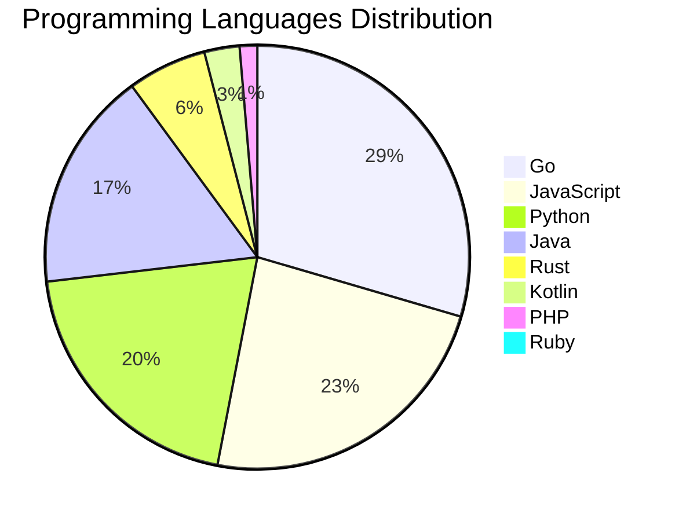

<div align="center">

# 📰 DevTech Auto News

**Your always-fresh digest of developer & AI tech news — curated automatically, around the clock.**


Aggregating [Dev.to](https://dev.to) · [Hacker News](https://news.ycombinator.com) · [GitHub Trending](https://github.com/trending) · [Lobste.rs](https://lobste.rs) · [Stack Overflow](https://stackoverflow.com) · [TechCrunch](https://techcrunch.com) · [freeCodeCamp](https://www.freecodecamp.org/news) — refreshed by GitHub Actions around the clock.

**[📰 Headlines](#-latest-headlines) · [💡 Interview Prep](#-interview-question-of-the-hour) · [📊 Statistics](#-statistics) · [⚙️ How It Works](#%EF%B8%8F-how-it-works)**

</div>

---

## 📰 Latest Headlines

> 🕐 Edition of **2026-10-29 4:00 CAT** — refreshed automatically, all day, every day.

### ✨ Featured Stories

<table>
<tr>
  <td align="center" width="33%">
    <a href="https://dev.to/devteam/your-dev-posts-have-a-beautiful-new-share-card-4be8">
      
      <br/>
      <b>Your DEV posts have a beautiful new share card ✨</b>
    </a>
    <br/>
    <sub>Dev.to</sub>
  </td>
  <td align="center" width="33%">
    <a href="https://dev.to/gde/accuracy-vs-speed-gemma-4-e2b-quantization-tradeoffs-bf16-to-q2k-aea">
      
      <br/>
      <b>Accuracy vs Speed: Gemma 4 E2B Quantization Tradeo...</b>
    </a>
    <br/>
    <sub>Dev.to</sub>
  </td>
  <td align="center" width="33%">
    <a href="https://dev.to/sloan/welcome-thread-v400-fho">
      
      <br/>
      <b>Welcome Thread - v399</b>
    </a>
    <br/>
    <sub>Dev.to</sub>
  </td>
</tr>
<tr>
  <td align="center" width="33%">
    <a href="https://dev.to/gde/size-your-model-to-where-you-run-it-gemma-4-e2b-and-e4b-on-an-aws-l4-and-two-small-gpus-1d47">
      
      <br/>
      <b>Size Your Model to Where You Run It: Gemma 4 E2B a...</b>
    </a>
    <br/>
    <sub>Dev.to</sub>
  </td>
  <td align="center" width="33%">
    <a href="https://dev.to/auth0/your-laptop-might-replace-most-of-your-ai-bill-4o1f">
      
      <br/>
      <b>Your Laptop Might Replace Most of Your AI Bill</b>
    </a>
    <br/>
    <sub>Dev.to</sub>
  </td>
  <td align="center" width="33%">
    <a href="https://dev.to/gde/inference-on-google-cloud-precision-memory-and-capacity-on-tpu-from-v5e-to-ironwood-5dlf">
      
      <br/>
      <b>Inference on Google Cloud: Precision, Memory and C...</b>
    </a>
    <br/>
    <sub>Dev.to</sub>
  </td>
</tr>
</table>


### 🗞️ Top Stories

| # | Headline | Source |
|---|----------|--------|
| 1 | [Your DEV posts have a beautiful new share card ✨](https://dev.to/devteam/your-dev-posts-have-a-beautiful-new-share-card-4be8) | Dev.to |
| 2 | [Accuracy vs Speed: Gemma 4 E2B Quantization Tradeoffs, BF16 to Q2_K](https://dev.to/gde/accuracy-vs-speed-gemma-4-e2b-quantization-tradeoffs-bf16-to-q2k-aea) | Dev.to |
| 3 | [Welcome Thread - v399](https://dev.to/sloan/welcome-thread-v400-fho) | Dev.to |
| 4 | [Size Your Model to Where You Run It: Gemma 4 E2B and E4B on an AWS L4 and Two Small GPUs](https://dev.to/gde/size-your-model-to-where-you-run-it-gemma-4-e2b-and-e4b-on-an-aws-l4-and-two-small-gpus-1d47) | Dev.to |
| 5 | [Your Laptop Might Replace Most of Your AI Bill](https://dev.to/auth0/your-laptop-might-replace-most-of-your-ai-bill-4o1f) | Dev.to |
| 6 | [Inference on Google Cloud: Precision, Memory and Capacity on TPU, from v5e to Ironwood](https://dev.to/gde/inference-on-google-cloud-precision-memory-and-capacity-on-tpu-from-v5e-to-ironwood-5dlf) | Dev.to |
| 7 | [Don't Be a Proxy Between Me and Your AI](https://dev.to/adamthedeveloper/dont-be-a-proxy-between-me-and-your-ai-mcn) | Dev.to |
| 8 | [Human-in-the-Loop Agents in Pure Dart: Genkit, MCP and an Approval Gate on Cloud Run](https://dev.to/gde/human-in-the-loop-agents-in-pure-dart-genkit-mcp-and-an-approval-gate-on-cloud-run-4gmc) | Dev.to |
| 9 | [Shipping Flutter Web to Firebase When Your GitHub Actions Budget Hits Zero](https://dev.to/gde/shipping-flutter-web-to-firebase-when-your-github-actions-budget-hits-zero-2mi5) | Dev.to |
| 10 | [I approved the order. Then my Genkit Dart agent forgot its own tool.](https://dev.to/gde/i-approved-the-order-then-my-genkit-dart-agent-forgot-its-own-tool-3mjp) | Dev.to |
| 11 | [Promise Delivered: Welcome to the DEV Hall of Fame (65 Authors, 65 Masterpieces)](https://dev.to/georgekobaidze/promise-delivered-welcome-to-the-dev-hall-of-fame-65-authors-65-masterpieces-15fa) | Dev.to |
| 12 | [Automated incident triage on GKE with Gemini 4 Argon and Model Context Protocol: Correlating cluster events and VPA logs](https://dev.to/googlecloud/automated-incident-triage-on-gke-with-gemini-4-argon-and-model-context-protocol-correlating-24eb) | Dev.to |
| 13 | [Top 7 Featured DEV Posts of the Week](https://dev.to/devteam/top-7-featured-dev-posts-of-the-week-2h0f) | Dev.to |
| 14 | [Natural Languages Have Design Trade-offs Too: Georgian Is Dynamically Typed, English Is Statically Typed](https://dev.to/georgekobaidze/natural-languages-have-design-trade-offs-too-georgian-is-dynamically-typed-english-is-statically-emi) | Dev.to |
| 15 | [Let It Die: The Lazy Email Agent on TabPFN, Gemma and Temporal](https://dev.to/khushighosh/let-it-die-the-lazy-email-agent-on-tabpfn-gemma-and-temporal-10o0) | Dev.to |
| 16 | [Beyond Passive AI Rewrites and Vibe Coding in Google Docs](https://dev.to/gde/beyond-passive-ai-rewrites-and-vibe-coding-in-google-docs-3db6) | Dev.to |
| 17 | [🐾 DEV Pet Corner #3: Show Us Your Pets!](https://dev.to/hemapriya_kanagala/dev-pet-corner-3-show-us-your-pets-35n) | Dev.to |
| 18 | [Building ora-tui with Google Antigravity & Gemini 4 Argon: An MS-DOS Retro TUI & OpenTelemetry Exporter for Oracle RAC, DB & SAN Multipath](https://dev.to/gde/building-ora-tui-with-google-antigravity-gemini-4-argon-an-ms-dos-retro-tui-opentelemetry-4d02) | Dev.to |
| 19 | [[Agent Platform in Action (6)] Towards Production-Grade AI Agent Ops: Building Full-Stack Observable LINE Agents with agents-cli](https://dev.to/gde/agent-platform-in-action-6-towards-production-grade-ai-agent-ops-building-full-stack-38aa) | Dev.to |
| 20 | [DuckLess: serverless DuckDB on Google Cloud, in your own project](https://dev.to/gde/duckless-serverless-duckdb-on-google-cloud-in-your-own-project-4o5a) | Dev.to |

<sub>Last fetched: Thu, 29 Oct 2026 04:43:11 CAT</sub>


---

## 💡 Interview Question of the Hour

> Sharpen your skills — new questions selected on every update. Try answering before opening the hint!

**1. `SystemDesign` — Design a distributed cache system**

&nbsp;&nbsp;&nbsp;&nbsp;🎯 Hard · 🏷 distributed systems, caching

<details>
<summary>&nbsp;&nbsp;&nbsp;&nbsp;💡 Show hint</summary>

> Consistency, partitioning, replication, eviction policies

</details>

**2. `NodeJS` — Implement rate limiting for an API**

&nbsp;&nbsp;&nbsp;&nbsp;🎯 Hard · 🏷 security, middleware

<details>
<summary>&nbsp;&nbsp;&nbsp;&nbsp;💡 Show hint</summary>

> Token bucket, sliding window, Redis

</details>

**3. `NodeJS` — Explain middleware in Express.js**

&nbsp;&nbsp;&nbsp;&nbsp;🎯 Easy · 🏷 express, architecture

<details>
<summary>&nbsp;&nbsp;&nbsp;&nbsp;💡 Show hint</summary>

> Request/response cycle, next(), chain of functions

</details>


---

## 📊 Statistics

#### 🗂 Articles by Category

| Category | Articles | Share | |
|----------|---------:|------:|---|
| **AI** | 79 | 42.9% | `████████████████████` |
| **Tools** | 40 | 21.7% | `██████████░░░░░░░░░░` |
| **JavaScript** | 35 | 19.0% | `█████████░░░░░░░░░░░` |
| **Python** | 30 | 16.3% | `████████░░░░░░░░░░░░` |
| **Cloud** | 21 | 11.4% | `█████░░░░░░░░░░░░░░░` |
| **Security** | 20 | 10.9% | `█████░░░░░░░░░░░░░░░` |
| **DevOps** | 18 | 9.8% | `█████░░░░░░░░░░░░░░░` |
| **Mobile** | 10 | 5.4% | `███░░░░░░░░░░░░░░░░░` |
| **Database** | 6 | 3.3% | `██░░░░░░░░░░░░░░░░░░` |
| **WebDev** | 5 | 2.7% | `█░░░░░░░░░░░░░░░░░░░` |

<sub>Articles can match more than one category, so shares may sum to over 100%.</sub>


#### 📡 Articles by Source

| Source | Articles |
|--------|---------:|
| Dev.to | 60 |
| HackerNews | 49 |
| GitHub | 25 |
| Lobste.rs | 10 |
| StackOverflow | 20 |
| TechCrunch | 10 |
| freeCodeCamp | 10 |


#### 💻 Programming Language Trends

```
Go              ██████████████████████████████ 29.1%
JavaScript      ████████████████████████ 23.2%
Python          █████████████████████ 19.9%
Java            █████████████████ 16.6%
Rust            ██████ 6.0%
Kotlin          ███ 2.6%
PHP             █ 1.3%
Ruby            █ 0.7%
CSharp          █ 0.7%

```




#### 🏷 Trending Topics

            


---

## ⚙️ How It Works

This repository is a fully automated news pipeline. On every run, GitHub Actions:

1. **Fetches** the latest articles from seven sources: Dev.to, Hacker News, GitHub Trending, Lobste.rs, Stack Overflow, TechCrunch, and freeCodeCamp
2. **Deduplicates and categorizes** them across 10+ topics using keyword matching
3. **Extracts cover images** and computes language & category statistics
4. **Rebuilds this README** and appends everything to the [full archive](./data/news_log.md)
5. **Commits and pushes** the result — no human intervention needed

<details>
<summary><b>🚀 Run it yourself</b></summary>

```bash
git clone https://github.com/Derrick-MUGISHA/github-activity-bot.git
cd github-activity-bot
npm install
npm start
```

Fork the repo, enable GitHub Actions, and you have your own self-updating news feed.

</details>

<details>
<summary><b>📚 Data & resources</b></summary>

- [Full news archive](./data/news_log.md) — complete history of every fetched article
- [Statistics](./data/stats.json) — raw stats data (JSON)
- [Categorized articles](./data/categorized.json) — articles grouped by topic
- [Interview question bank](./data/interview_questions.json) — the full question set

</details>

---

## 🤝 Contributing

Ideas for new sources, categories, or interview questions are welcome — [open an issue](https://github.com/Derrick-MUGISHA/github-activity-bot/issues/new) or submit a pull request.

## 📄 License

Released under the [MIT License](https://opensource.org/licenses/MIT) — free to use, fork, and modify.

---

<div align="center">
  <sub>🤖 Last automated update: <b>Thu, 29 Oct 2026 02:43:11 GMT</b></sub><br/>
  <sub>Powered by GitHub Actions · Built with ❤️ by <a href="https://github.com/Derrick-MUGISHA">Derrick MUGISHA</a></sub>
</div>
