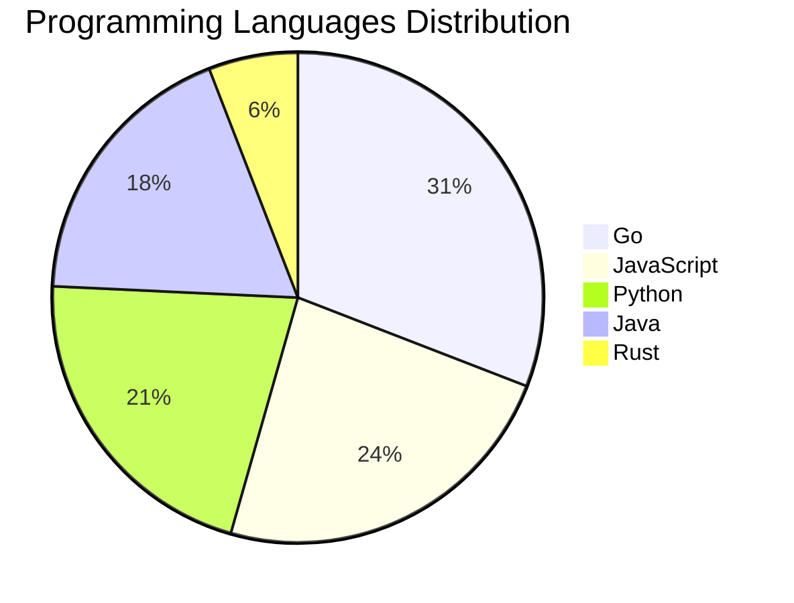

<div align="center">

# 📰 DevTech Auto News

**Your always-fresh digest of developer & AI tech news — curated automatically, around the clock.**


Aggregating [Dev.to](https://dev.to) · [Hacker News](https://news.ycombinator.com) · [GitHub Trending](https://github.com/trending) · [Lobste.rs](https://lobste.rs) · [Stack Overflow](https://stackoverflow.com) · [TechCrunch](https://techcrunch.com) · [freeCodeCamp](https://www.freecodecamp.org/news) — refreshed by GitHub Actions around the clock.

**[📰 Headlines](#-latest-headlines) · [💡 Interview Prep](#-interview-question-of-the-hour) · [📊 Statistics](#-statistics) · [⚙️ How It Works](#%EF%B8%8F-how-it-works)**

</div>

---

## 📰 Latest Headlines

> 🕐 Edition of **2026-11-02 10:00 CAT** — refreshed automatically, all day, every day.

### ✨ Featured Stories

<table>
<tr>
  <td align="center" width="33%">
    <a href="https://dev.to/devteam/what-was-your-win-this-week-47ci">
      
      <br/>
      <b>What was your win this week?</b>
    </a>
    <br/>
    <sub>Dev.to</sub>
  </td>
  <td align="center" width="33%">
    <a href="https://dev.to/gde/giving-ai-pain-the-architecture-of-synthetic-scars-the-rapid-regret-miner-1740">
      
      <br/>
      <b>Giving AI Pain: The Architecture of Synthetic Scar...</b>
    </a>
    <br/>
    <sub>Dev.to</sub>
  </td>
  <td align="center" width="33%">
    <a href="https://dev.to/pengeszikra/singularity-news-ccg-5ejk">
      
      <br/>
      <b>Singularity News :: CCG</b>
    </a>
    <br/>
    <sub>Dev.to</sub>
  </td>
</tr>
<tr>
  <td align="center" width="33%">
    <a href="https://dev.to/devteam/your-dev-posts-have-a-beautiful-new-share-card-4be8">
      
      <br/>
      <b>Your DEV posts have a beautiful new share card ✨</b>
    </a>
    <br/>
    <sub>Dev.to</sub>
  </td>
  <td align="center" width="33%">
    <a href="https://dev.to/gde/zero-trust-cicd-keyless-bitbucket-deployment-on-google-cloud-1ka1">
      
      <br/>
      <b>Zero Trust CI/CD: Keyless Bitbucket Deployment on ...</b>
    </a>
    <br/>
    <sub>Dev.to</sub>
  </td>
  <td align="center" width="33%">
    <a href="https://dev.to/yong_yu_f98e15562e9b120a0/gemini-4-carbon-is-1-on-aa-index-still-fairwind-only-cyber-benches-210-420-and-what-to-b66">
      
      <br/>
      <b>Gemini 4 Carbon Is #1 on AA Index — Still Fairwind...</b>
    </a>
    <br/>
    <sub>Dev.to</sub>
  </td>
</tr>
</table>


### 🗞️ Top Stories

| # | Headline | Source |
|---|----------|--------|
| 1 | [What was your win this week?](https://dev.to/devteam/what-was-your-win-this-week-47ci) | Dev.to |
| 2 | [Giving AI Pain: The Architecture of Synthetic Scars & The Rapid-Regret Miner](https://dev.to/gde/giving-ai-pain-the-architecture-of-synthetic-scars-the-rapid-regret-miner-1740) | Dev.to |
| 3 | [Singularity News :: CCG](https://dev.to/pengeszikra/singularity-news-ccg-5ejk) | Dev.to |
| 4 | [Your DEV posts have a beautiful new share card ✨](https://dev.to/devteam/your-dev-posts-have-a-beautiful-new-share-card-4be8) | Dev.to |
| 5 | [Zero Trust CI/CD: Keyless Bitbucket Deployment on Google Cloud](https://dev.to/gde/zero-trust-cicd-keyless-bitbucket-deployment-on-google-cloud-1ka1) | Dev.to |
| 6 | [Gemini 4 Carbon Is #1 on AA Index — Still Fairwind-Only: Cyber Benches, $2/$10 $4/$20, and What to Do Before the API](https://dev.to/yong_yu_f98e15562e9b120a0/gemini-4-carbon-is-1-on-aa-index-still-fairwind-only-cyber-benches-210-420-and-what-to-b66) | Dev.to |
| 7 | [Is Tech Actually Welcoming to Beginners, or Do We Just Say It Is?](https://dev.to/sizzlebop/is-tech-actually-welcoming-to-beginners-or-do-we-just-say-it-is-3d6p) | Dev.to |
| 8 | [Don't Be a Proxy Between Me and Your AI](https://dev.to/adamthedeveloper/dont-be-a-proxy-between-me-and-your-ai-mcn) | Dev.to |
| 9 | [Promise Delivered: Welcome to the DEV Hall of Fame (65 Authors, 65 Masterpieces)](https://dev.to/georgekobaidze/promise-delivered-welcome-to-the-dev-hall-of-fame-65-authors-65-masterpieces-15fa) | Dev.to |
| 10 | [AI Dev Weekly #32: GPT-6.1 Terra, Gemini Carbon, Kimi K3.1 and Copilot Fusion](https://dev.to/ai_made_tools/ai-dev-weekly-32-gpt-61-terra-gemini-carbon-kimi-k31-and-copilot-fusion-3mpi) | Dev.to |
| 11 | [Natural Languages Have Design Trade-offs Too: Georgian Is Dynamically Typed, English Is Statically Typed](https://dev.to/georgekobaidze/natural-languages-have-design-trade-offs-too-georgian-is-dynamically-typed-english-is-statically-emi) | Dev.to |
| 12 | [Building ora-tui with Google Antigravity & Gemini 4 Argon: An MS-DOS Retro TUI & OpenTelemetry Exporter for Oracle RAC, DB & SAN Multipath](https://dev.to/gde/building-ora-tui-with-google-antigravity-gemini-4-argon-an-ms-dos-retro-tui-opentelemetry-4d02) | Dev.to |
| 13 | [[Agent Platform in Action (6)] Towards Production-Grade AI Agent Ops: Building Full-Stack Observable LINE Agents with agents-cli](https://dev.to/gde/agent-platform-in-action-6-towards-production-grade-ai-agent-ops-building-full-stack-38aa) | Dev.to |
| 14 | [Accuracy vs Speed: Gemma 4 E2B Quantization Tradeoffs, BF16 to Q2_K](https://dev.to/gde/accuracy-vs-speed-gemma-4-e2b-quantization-tradeoffs-bf16-to-q2k-aea) | Dev.to |
| 15 | [DuckLess: serverless DuckDB on Google Cloud, in your own project](https://dev.to/gde/duckless-serverless-duckdb-on-google-cloud-in-your-own-project-4o5a) | Dev.to |
| 16 | [GPT-6 Is Coming to Google Cloud. Is Your AI Bill Ready?](https://dev.to/gde/gpt-6-is-coming-to-google-cloud-is-your-ai-bill-ready-j7l) | Dev.to |
| 17 | [Autonomous agent loops with Gemini 4 Argon and GKE Agent Sandbox: Running untrusted code safely at scale](https://dev.to/googlecloud/autonomous-agent-loops-with-gemini-4-argon-and-gke-agent-sandbox-running-untrusted-code-safely-at-2k60) | Dev.to |
| 18 | [Welcome Thread - v399](https://dev.to/sloan/welcome-thread-v400-fho) | Dev.to |
| 19 | [Human-in-the-Loop Agents in Pure Dart: Genkit, MCP and an Approval Gate on Cloud Run](https://dev.to/gde/human-in-the-loop-agents-in-pure-dart-genkit-mcp-and-an-approval-gate-on-cloud-run-4gmc) | Dev.to |
| 20 | [Why bloc.add(...) Isn't What You Think: Synchronous Event Fast-Paths and 0ms Form Bindings](https://dev.to/gde/why-blocadd-isnt-what-you-think-synchronous-event-fast-paths-and-0ms-form-bindings-6o) | Dev.to |

<sub>Last fetched: Mon, 02 Nov 2026 10:43:49 CAT</sub>


---

## 💡 Interview Question of the Hour

> Sharpen your skills — new questions selected on every update. Try answering before opening the hint!

**1. `Python` — Explain GIL and its implications for multithreading**

&nbsp;&nbsp;&nbsp;&nbsp;🎯 Hard · 🏷 concurrency, performance

<details>
<summary>&nbsp;&nbsp;&nbsp;&nbsp;💡 Show hint</summary>

> Global Interpreter Lock, multiprocessing alternatives

</details>

**2. `NodeJS` — What is the difference between process.nextTick() and setImmediate()?**

&nbsp;&nbsp;&nbsp;&nbsp;🎯 Medium · 🏷 event loop, async

<details>
<summary>&nbsp;&nbsp;&nbsp;&nbsp;💡 Show hint</summary>

> Execution timing, event loop phases

</details>

**3. `Java` — Explain the Java memory model**

&nbsp;&nbsp;&nbsp;&nbsp;🎯 Hard · 🏷 memory, JVM

<details>
<summary>&nbsp;&nbsp;&nbsp;&nbsp;💡 Show hint</summary>

> Heap, stack, garbage collection

</details>


---

## 📊 Statistics

#### 🗂 Articles by Category

| Category | Articles | Share | |
|----------|---------:|------:|---|
| **AI** | 80 | 43.5% | `████████████████████` |
| **Tools** | 39 | 21.2% | `██████████░░░░░░░░░░` |
| **JavaScript** | 32 | 17.4% | `████████░░░░░░░░░░░░` |
| **Python** | 29 | 15.8% | `███████░░░░░░░░░░░░░` |
| **Security** | 17 | 9.2% | `████░░░░░░░░░░░░░░░░` |
| **DevOps** | 16 | 8.7% | `████░░░░░░░░░░░░░░░░` |
| **Cloud** | 15 | 8.2% | `████░░░░░░░░░░░░░░░░` |
| **WebDev** | 8 | 4.3% | `██░░░░░░░░░░░░░░░░░░` |
| **Database** | 8 | 4.3% | `██░░░░░░░░░░░░░░░░░░` |
| **Mobile** | 6 | 3.3% | `██░░░░░░░░░░░░░░░░░░` |

<sub>Articles can match more than one category, so shares may sum to over 100%.</sub>


#### 📡 Articles by Source

| Source | Articles |
|--------|---------:|
| Dev.to | 60 |
| HackerNews | 49 |
| GitHub | 25 |
| Lobste.rs | 10 |
| StackOverflow | 20 |
| TechCrunch | 10 |
| freeCodeCamp | 10 |


#### 💻 Programming Language Trends

```
Go              ██████████████████████████████ 30.9%
JavaScript      ███████████████████████ 23.5%
Python          █████████████████████ 21.3%
Java            ██████████████████ 18.4%
Rust            ██████ 5.9%

```




#### 🏷 Trending Topics

            


---

## ⚙️ How It Works

This repository is a fully automated news pipeline. On every run, GitHub Actions:

1. **Fetches** the latest articles from seven sources: Dev.to, Hacker News, GitHub Trending, Lobste.rs, Stack Overflow, TechCrunch, and freeCodeCamp
2. **Deduplicates and categorizes** them across 10+ topics using keyword matching
3. **Extracts cover images** and computes language & category statistics
4. **Rebuilds this README** and appends everything to the [full archive](./data/news_log.md)
5. **Commits and pushes** the result — no human intervention needed

<details>
<summary><b>🚀 Run it yourself</b></summary>

```bash
git clone https://github.com/Derrick-MUGISHA/github-activity-bot.git
cd github-activity-bot
npm install
npm start
```

Fork the repo, enable GitHub Actions, and you have your own self-updating news feed.

</details>

<details>
<summary><b>📚 Data & resources</b></summary>

- [Full news archive](./data/news_log.md) — complete history of every fetched article
- [Statistics](./data/stats.json) — raw stats data (JSON)
- [Categorized articles](./data/categorized.json) — articles grouped by topic
- [Interview question bank](./data/interview_questions.json) — the full question set

</details>

---

## 🤝 Contributing

Ideas for new sources, categories, or interview questions are welcome — [open an issue](https://github.com/Derrick-MUGISHA/github-activity-bot/issues/new) or submit a pull request.

## 📄 License

Released under the [MIT License](https://opensource.org/licenses/MIT) — free to use, fork, and modify.

---

<div align="center">
  <sub>🤖 Last automated update: <b>Mon, 02 Nov 2026 08:43:49 GMT</b></sub><br/>
  <sub>Powered by GitHub Actions · Built with ❤️ by <a href="https://github.com/Derrick-MUGISHA">Derrick MUGISHA</a></sub>
</div>
