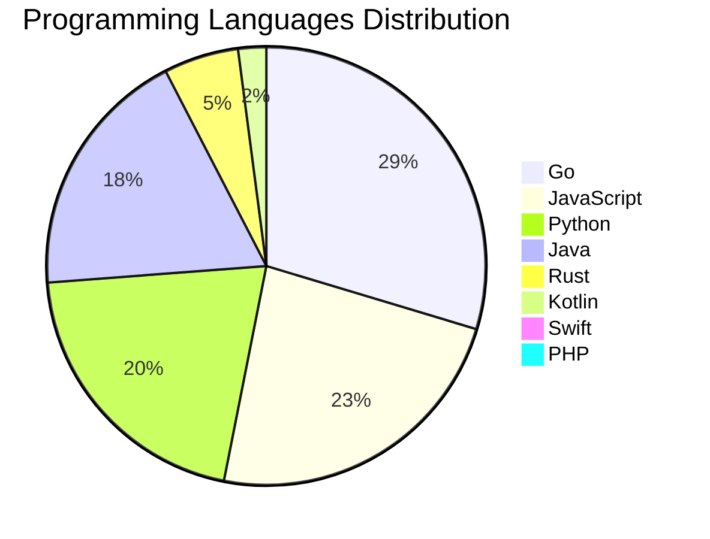

<div align="center">

# 📰 DevTech Auto News

**Your always-fresh digest of developer & AI tech news — curated automatically, around the clock.**


Aggregating [Dev.to](https://dev.to) · [Hacker News](https://news.ycombinator.com) · [GitHub Trending](https://github.com/trending) · [Lobste.rs](https://lobste.rs) · [Stack Overflow](https://stackoverflow.com) · [TechCrunch](https://techcrunch.com) · [freeCodeCamp](https://www.freecodecamp.org/news) — refreshed by GitHub Actions around the clock.

**[📰 Headlines](#-latest-headlines) · [💡 Interview Prep](#-interview-question-of-the-hour) · [📊 Statistics](#-statistics) · [⚙️ How It Works](#%EF%B8%8F-how-it-works)**

</div>

---

## 📰 Latest Headlines

> 🕐 Edition of **2026-10-31 10:00 CAT** — refreshed automatically, all day, every day.

### ✨ Featured Stories

<table>
<tr>
  <td align="center" width="33%">
    <a href="https://dev.to/devteam/your-dev-posts-have-a-beautiful-new-share-card-4be8">
      
      <br/>
      <b>Your DEV posts have a beautiful new share card ✨</b>
    </a>
    <br/>
    <sub>Dev.to</sub>
  </td>
  <td align="center" width="33%">
    <a href="https://dev.to/devteam/what-was-your-win-this-week-47ci">
      
      <br/>
      <b>What was your win this week?</b>
    </a>
    <br/>
    <sub>Dev.to</sub>
  </td>
  <td align="center" width="33%">
    <a href="https://dev.to/gde/giving-ai-pain-the-architecture-of-synthetic-scars-the-rapid-regret-miner-1740">
      
      <br/>
      <b>Giving AI Pain: The Architecture of Synthetic Scar...</b>
    </a>
    <br/>
    <sub>Dev.to</sub>
  </td>
</tr>
<tr>
  <td align="center" width="33%">
    <a href="https://dev.to/sizzlebop/is-tech-actually-welcoming-to-beginners-or-do-we-just-say-it-is-3d6p">
      
      <br/>
      <b>Is Tech Actually Welcoming to Beginners, or Do We ...</b>
    </a>
    <br/>
    <sub>Dev.to</sub>
  </td>
  <td align="center" width="33%">
    <a href="https://dev.to/devteam/congrats-to-the-hacktoberfest-open-source-ai-challenge-week-3-slow-and-steady-winners-3e4a">
      
      <br/>
      <b>Congrats to the Hacktoberfest Open-Source AI Chall...</b>
    </a>
    <br/>
    <sub>Dev.to</sub>
  </td>
  <td align="center" width="33%">
    <a href="https://dev.to/gde/four-gpus-one-quantization-ladder-gemma-4-e2b-from-a-4-gb-laptop-to-an-nvidia-l4-4olp">
      
      <br/>
      <b>Four GPUs, One Quantization Ladder: Gemma 4 E2B Fr...</b>
    </a>
    <br/>
    <sub>Dev.to</sub>
  </td>
</tr>
</table>


### 🗞️ Top Stories

| # | Headline | Source |
|---|----------|--------|
| 1 | [Your DEV posts have a beautiful new share card ✨](https://dev.to/devteam/your-dev-posts-have-a-beautiful-new-share-card-4be8) | Dev.to |
| 2 | [What was your win this week?](https://dev.to/devteam/what-was-your-win-this-week-47ci) | Dev.to |
| 3 | [Giving AI Pain: The Architecture of Synthetic Scars & The Rapid-Regret Miner](https://dev.to/gde/giving-ai-pain-the-architecture-of-synthetic-scars-the-rapid-regret-miner-1740) | Dev.to |
| 4 | [Is Tech Actually Welcoming to Beginners, or Do We Just Say It Is?](https://dev.to/sizzlebop/is-tech-actually-welcoming-to-beginners-or-do-we-just-say-it-is-3d6p) | Dev.to |
| 5 | [Congrats to the Hacktoberfest Open-Source AI Challenge Week 3: Slow and Steady Winners!](https://dev.to/devteam/congrats-to-the-hacktoberfest-open-source-ai-challenge-week-3-slow-and-steady-winners-3e4a) | Dev.to |
| 6 | [Four GPUs, One Quantization Ladder: Gemma 4 E2B From a 4 GB Laptop to an NVIDIA L4](https://dev.to/gde/four-gpus-one-quantization-ladder-gemma-4-e2b-from-a-4-gb-laptop-to-an-nvidia-l4-4olp) | Dev.to |
| 7 | [Build a production-style Autonomous SRE Command Center using Gemini 4 Argon](https://dev.to/gde/build-a-production-style-autonomous-sre-command-center-using-gemini-4-argon-759) | Dev.to |
| 8 | [Welcome to the Prompt Pad: AI Tips & Tricks with Rosendo Pili](https://blog.mlh.com/welcome-to-the-prompt-pad-ai-tips-tricks-with-rosendo-pili-2hkl) | Dev.to |
| 9 | [Size Your Model to Where You Run It: Gemma 4 E2B and E4B on an AWS L4 and Two Small GPUs](https://dev.to/gde/size-your-model-to-where-you-run-it-gemma-4-e2b-and-e4b-on-an-aws-l4-and-two-small-gpus-1d47) | Dev.to |
| 10 | [Zero Trust CI/CD: Keyless Bitbucket Deployment on Google Cloud](https://dev.to/gde/zero-trust-cicd-keyless-bitbucket-deployment-on-google-cloud-1ka1) | Dev.to |
| 11 | [Gemini 4 Carbon Is #1 on AA Index — Still Fairwind-Only: Cyber Benches, $2/$10 $4/$20, and What to Do Before the API](https://dev.to/yong_yu_f98e15562e9b120a0/gemini-4-carbon-is-1-on-aa-index-still-fairwind-only-cyber-benches-210-420-and-what-to-b66) | Dev.to |
| 12 | [AI Dev Weekly #32: GPT-6.1 Terra, Gemini Carbon, Kimi K3.1 and Copilot Fusion](https://dev.to/ai_made_tools/ai-dev-weekly-32-gpt-61-terra-gemini-carbon-kimi-k31-and-copilot-fusion-3mpi) | Dev.to |
| 13 | [Performance vs Quality: Gemma 4 E2B Quantization on an NVIDIA L4 and a Tesla T4](https://dev.to/gde/performance-vs-quality-gemma-4-e2b-quantization-on-an-nvidia-l4-and-a-tesla-t4-4b90) | Dev.to |
| 14 | [Inference on Google Cloud: Precision, Memory and Capacity on TPU, from v5e to Ironwood](https://dev.to/gde/inference-on-google-cloud-precision-memory-and-capacity-on-tpu-from-v5e-to-ironwood-5dlf) | Dev.to |
| 15 | [Welcome Thread - v399](https://dev.to/sloan/welcome-thread-v400-fho) | Dev.to |
| 16 | [Don't Be a Proxy Between Me and Your AI](https://dev.to/adamthedeveloper/dont-be-a-proxy-between-me-and-your-ai-mcn) | Dev.to |
| 17 | [Promise Delivered: Welcome to the DEV Hall of Fame (65 Authors, 65 Masterpieces)](https://dev.to/georgekobaidze/promise-delivered-welcome-to-the-dev-hall-of-fame-65-authors-65-masterpieces-15fa) | Dev.to |
| 18 | [Your Laptop Might Replace Most of Your AI Bill](https://dev.to/auth0/your-laptop-might-replace-most-of-your-ai-bill-4o1f) | Dev.to |
| 19 | [Natural Languages Have Design Trade-offs Too: Georgian Is Dynamically Typed, English Is Statically Typed](https://dev.to/georgekobaidze/natural-languages-have-design-trade-offs-too-georgian-is-dynamically-typed-english-is-statically-emi) | Dev.to |
| 20 | [Building ora-tui with Google Antigravity & Gemini 4 Argon: An MS-DOS Retro TUI & OpenTelemetry Exporter for Oracle RAC, DB & SAN Multipath](https://dev.to/gde/building-ora-tui-with-google-antigravity-gemini-4-argon-an-ms-dos-retro-tui-opentelemetry-4d02) | Dev.to |

<sub>Last fetched: Sat, 31 Oct 2026 10:03:19 CAT</sub>


---

## 💡 Interview Question of the Hour

> Sharpen your skills — new questions selected on every update. Try answering before opening the hint!

**1. `DataStructures` — Find the longest substring without repeating characters**

&nbsp;&nbsp;&nbsp;&nbsp;🎯 Medium · 🏷 strings, sliding window

<details>
<summary>&nbsp;&nbsp;&nbsp;&nbsp;💡 Show hint</summary>

> Sliding window, hash map, two pointers

</details>

**2. `NodeJS` — Explain middleware in Express.js**

&nbsp;&nbsp;&nbsp;&nbsp;🎯 Easy · 🏷 express, architecture

<details>
<summary>&nbsp;&nbsp;&nbsp;&nbsp;💡 Show hint</summary>

> Request/response cycle, next(), chain of functions

</details>

**3. `Database` — Design a database schema for a social media platform**

&nbsp;&nbsp;&nbsp;&nbsp;🎯 Hard · 🏷 design, scalability

<details>
<summary>&nbsp;&nbsp;&nbsp;&nbsp;💡 Show hint</summary>

> Users, posts, relationships, indexes, partitioning

</details>


---

## 📊 Statistics

#### 🗂 Articles by Category

| Category | Articles | Share | |
|----------|---------:|------:|---|
| **AI** | 75 | 40.8% | `████████████████████` |
| **Tools** | 39 | 21.2% | `██████████░░░░░░░░░░` |
| **JavaScript** | 34 | 18.5% | `█████████░░░░░░░░░░░` |
| **Python** | 30 | 16.3% | `████████░░░░░░░░░░░░` |
| **Cloud** | 20 | 10.9% | `█████░░░░░░░░░░░░░░░` |
| **Security** | 19 | 10.3% | `█████░░░░░░░░░░░░░░░` |
| **DevOps** | 16 | 8.7% | `████░░░░░░░░░░░░░░░░` |
| **Mobile** | 9 | 4.9% | `██░░░░░░░░░░░░░░░░░░` |
| **Database** | 6 | 3.3% | `██░░░░░░░░░░░░░░░░░░` |
| **WebDev** | 4 | 2.2% | `█░░░░░░░░░░░░░░░░░░░` |

<sub>Articles can match more than one category, so shares may sum to over 100%.</sub>


#### 📡 Articles by Source

| Source | Articles |
|--------|---------:|
| Dev.to | 60 |
| HackerNews | 49 |
| GitHub | 25 |
| Lobste.rs | 10 |
| StackOverflow | 20 |
| TechCrunch | 10 |
| freeCodeCamp | 10 |


#### 💻 Programming Language Trends

```
Go              ██████████████████████████████ 29.3%
JavaScript      ████████████████████████ 23.1%
Python          █████████████████████ 20.4%
Java            ███████████████████ 18.4%
Rust            ██████ 5.4%
Kotlin          ██ 2.0%
Swift           █ 0.7%
PHP             █ 0.7%

```




#### 🏷 Trending Topics

            


---

## ⚙️ How It Works

This repository is a fully automated news pipeline. On every run, GitHub Actions:

1. **Fetches** the latest articles from seven sources: Dev.to, Hacker News, GitHub Trending, Lobste.rs, Stack Overflow, TechCrunch, and freeCodeCamp
2. **Deduplicates and categorizes** them across 10+ topics using keyword matching
3. **Extracts cover images** and computes language & category statistics
4. **Rebuilds this README** and appends everything to the [full archive](./data/news_log.md)
5. **Commits and pushes** the result — no human intervention needed

<details>
<summary><b>🚀 Run it yourself</b></summary>

```bash
git clone https://github.com/Derrick-MUGISHA/github-activity-bot.git
cd github-activity-bot
npm install
npm start
```

Fork the repo, enable GitHub Actions, and you have your own self-updating news feed.

</details>

<details>
<summary><b>📚 Data & resources</b></summary>

- [Full news archive](./data/news_log.md) — complete history of every fetched article
- [Statistics](./data/stats.json) — raw stats data (JSON)
- [Categorized articles](./data/categorized.json) — articles grouped by topic
- [Interview question bank](./data/interview_questions.json) — the full question set

</details>

---

## 🤝 Contributing

Ideas for new sources, categories, or interview questions are welcome — [open an issue](https://github.com/Derrick-MUGISHA/github-activity-bot/issues/new) or submit a pull request.

## 📄 License

Released under the [MIT License](https://opensource.org/licenses/MIT) — free to use, fork, and modify.

---

<div align="center">
  <sub>🤖 Last automated update: <b>Sat, 31 Oct 2026 08:03:19 GMT</b></sub><br/>
  <sub>Powered by GitHub Actions · Built with ❤️ by <a href="https://github.com/Derrick-MUGISHA">Derrick MUGISHA</a></sub>
</div>
