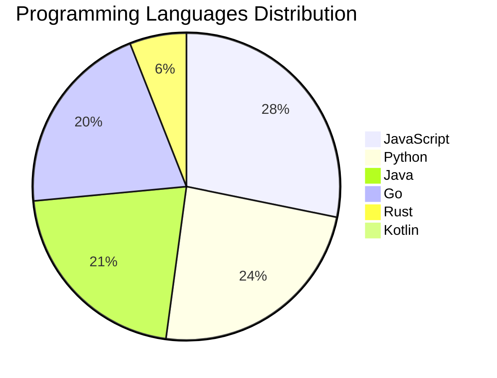

<div align="center">

# 📰 DevTech Auto News

**Your always-fresh digest of developer & AI tech news — curated automatically, around the clock.**


Aggregating [Dev.to](https://dev.to) · [Hacker News](https://news.ycombinator.com) · [GitHub Trending](https://github.com/trending) · [Lobste.rs](https://lobste.rs) · [Stack Overflow](https://stackoverflow.com) · [TechCrunch](https://techcrunch.com) · [freeCodeCamp](https://www.freecodecamp.org/news) — refreshed by GitHub Actions around the clock.

**[📰 Headlines](#-latest-headlines) · [💡 Interview Prep](#-interview-question-of-the-hour) · [📊 Statistics](#-statistics) · [⚙️ How It Works](#%EF%B8%8F-how-it-works)**

</div>

---

## 📰 Latest Headlines

> 🕐 Edition of **2026-10-14 1:00 CAT** — refreshed automatically, all day, every day.

### ✨ Featured Stories

<table>
<tr>
  <td align="center" width="33%">
    <a href="https://dev.to/jess/how-i-feel-about-the-grace-hopper-celebration-getting-cancelled-3l2k">
      
      <br/>
      <b>How I Feel about the Grace Hopper Celebration Gett...</b>
    </a>
    <br/>
    <sub>Dev.to</sub>
  </td>
  <td align="center" width="33%">
    <a href="https://dev.to/dailycontext/what-9050-ai-written-scripts-taught-me-about-slop-1g5n">
      
      <br/>
      <b>What 9,050 AI-Written Scripts Taught Me About Slop</b>
    </a>
    <br/>
    <sub>Dev.to</sub>
  </td>
  <td align="center" width="33%">
    <a href="https://dev.to/gde/local-embeddings-with-llamadart-how-llamas-share-secrets-46o">
      
      <br/>
      <b>Local embeddings with llamadart: how llamas share ...</b>
    </a>
    <br/>
    <sub>Dev.to</sub>
  </td>
</tr>
<tr>
  <td align="center" width="33%">
    <a href="https://dev.to/dailycontext/ai-needs-a-test-that-fights-back-4f17">
      
      <br/>
      <b>AI Needs a Test That Fights Back</b>
    </a>
    <br/>
    <sub>Dev.to</sub>
  </td>
  <td align="center" width="33%">
    <a href="https://dev.to/dailycontext/one-weekend-3000-open-source-ai-projects-3g65">
      
      <br/>
      <b>One Weekend: 3,000 Open-Source AI Projects</b>
    </a>
    <br/>
    <sub>Dev.to</sub>
  </td>
  <td align="center" width="33%">
    <a href="https://dev.to/devteam/top-7-featured-dev-posts-of-the-week-1bo6">
      
      <br/>
      <b>Top 7 Featured DEV Posts of the Week</b>
    </a>
    <br/>
    <sub>Dev.to</sub>
  </td>
</tr>
</table>


### 🗞️ Top Stories

| # | Headline | Source |
|---|----------|--------|
| 1 | [How I Feel about the Grace Hopper Celebration Getting Cancelled](https://dev.to/jess/how-i-feel-about-the-grace-hopper-celebration-getting-cancelled-3l2k) | Dev.to |
| 2 | [What 9,050 AI-Written Scripts Taught Me About Slop](https://dev.to/dailycontext/what-9050-ai-written-scripts-taught-me-about-slop-1g5n) | Dev.to |
| 3 | [Local embeddings with llamadart: how llamas share secrets](https://dev.to/gde/local-embeddings-with-llamadart-how-llamas-share-secrets-46o) | Dev.to |
| 4 | [AI Needs a Test That Fights Back](https://dev.to/dailycontext/ai-needs-a-test-that-fights-back-4f17) | Dev.to |
| 5 | [One Weekend: 3,000 Open-Source AI Projects](https://dev.to/dailycontext/one-weekend-3000-open-source-ai-projects-3g65) | Dev.to |
| 6 | [Top 7 Featured DEV Posts of the Week](https://dev.to/devteam/top-7-featured-dev-posts-of-the-week-1bo6) | Dev.to |
| 7 | [ROI That Survives the Second Question](https://dev.to/dailycontext/roi-that-survives-the-second-question-4na0) | Dev.to |
| 8 | [Agents Can’t Decide What’s Okay to Break](https://dev.to/dailycontext/agents-cant-decide-whats-okay-to-break-3ncg) | Dev.to |
| 9 | [Where to Spend Your Week at AI Engineer New York](https://dev.to/dailycontext/where-to-spend-your-week-at-ai-engineer-new-york-3lg) | Dev.to |
| 10 | [Frontier AI models outperform human experts on earnings prediction for the first time](https://dev.to/dailycontext/frontier-ai-models-outperform-human-experts-on-earnings-prediction-for-the-first-time-3fhb) | Dev.to |
| 11 | [How Anthropic’s Dynamic Workflows Coordinate Claude Agents](https://dev.to/dailycontext/how-anthropics-dynamic-workflows-coordinate-claude-agents-3f23) | Dev.to |
| 12 | [Brakes Let You Go Fast: Balancing Acceleration and Safety for AI Agents](https://dev.to/dailycontext/brakes-let-you-go-fast-balancing-acceleration-and-safety-for-ai-agents-49p9) | Dev.to |
| 13 | [Code is abundant. Confidence is a formula.](https://dev.to/dailycontext/code-is-abundant-confidence-is-a-formula-gn6) | Dev.to |
| 14 | [What 1,368 Real-World AI Incidents Teach Us About Evaluation](https://dev.to/dailycontext/what-1368-real-world-ai-incidents-teach-us-about-evaluation-71p) | Dev.to |
| 15 | [Meme Monday](https://dev.to/ben/meme-monday-4e47) | Dev.to |
| 16 | [Inaugural AI Engineer NYC Hackathon Kicks Off Conference Week With 50+ Projects](https://dev.to/dailycontext/inaugural-ai-engineer-nyc-hackathon-kicks-off-conference-week-with-50-projects-59g) | Dev.to |
| 17 | [AI Engineering Has Entered Its Audit Era](https://dev.to/dailycontext/ai-engineering-has-entered-its-audit-era-56fl) | Dev.to |
| 18 | [Kepler's Vinoo Ganesh on Building AI You Can Trust](https://dev.to/dailycontext/keplers-vinoo-ganesh-on-building-ai-you-can-trust-3p0f) | Dev.to |
| 19 | [Workshop Day Opens AI Engineer NYC](https://dev.to/dailycontext/workshop-day-opens-ai-engineer-nyc-23i2) | Dev.to |
| 20 | [What LLMs 'Know' That You Don't Know They Know: Stop Inventing Prompt DSLs and Ride 50 Years of Unix Pre-Training Gravity](https://dev.to/gde/what-llms-know-that-you-dont-know-they-know-stop-inventing-prompt-dsls-and-ride-50-years-of-2bl6) | Dev.to |

<sub>Last fetched: Wed, 14 Oct 2026 01:56:26 CAT</sub>


---

## 💡 Interview Question of the Hour

> Sharpen your skills — new questions selected on every update. Try answering before opening the hint!

**1. `React` — How would you optimize a React app's performance?**

&nbsp;&nbsp;&nbsp;&nbsp;🎯 Hard · 🏷 optimization, performance

<details>
<summary>&nbsp;&nbsp;&nbsp;&nbsp;💡 Show hint</summary>

> React.memo, useMemo, useCallback, code splitting, lazy loading

</details>

**2. `Python` — Explain GIL and its implications for multithreading**

&nbsp;&nbsp;&nbsp;&nbsp;🎯 Hard · 🏷 concurrency, performance

<details>
<summary>&nbsp;&nbsp;&nbsp;&nbsp;💡 Show hint</summary>

> Global Interpreter Lock, multiprocessing alternatives

</details>

**3. `Python` — Explain GIL and its implications for multithreading**

&nbsp;&nbsp;&nbsp;&nbsp;🎯 Hard · 🏷 concurrency, performance

<details>
<summary>&nbsp;&nbsp;&nbsp;&nbsp;💡 Show hint</summary>

> Global Interpreter Lock, multiprocessing alternatives

</details>


---

## 📊 Statistics

#### 🗂 Articles by Category

| Category | Articles | Share | |
|----------|---------:|------:|---|
| **AI** | 89 | 48.4% | `████████████████████` |
| **Tools** | 45 | 24.5% | `██████████░░░░░░░░░░` |
| **JavaScript** | 33 | 17.9% | `███████░░░░░░░░░░░░░` |
| **Python** | 28 | 15.2% | `██████░░░░░░░░░░░░░░` |
| **Security** | 18 | 9.8% | `████░░░░░░░░░░░░░░░░` |
| **DevOps** | 15 | 8.2% | `███░░░░░░░░░░░░░░░░░` |
| **Cloud** | 8 | 4.3% | `██░░░░░░░░░░░░░░░░░░` |
| **WebDev** | 7 | 3.8% | `██░░░░░░░░░░░░░░░░░░` |
| **Database** | 4 | 2.2% | `█░░░░░░░░░░░░░░░░░░░` |
| **Mobile** | 2 | 1.1% | `░░░░░░░░░░░░░░░░░░░░` |

<sub>Articles can match more than one category, so shares may sum to over 100%.</sub>


#### 📡 Articles by Source

| Source | Articles |
|--------|---------:|
| Dev.to | 60 |
| HackerNews | 49 |
| GitHub | 25 |
| Lobste.rs | 10 |
| StackOverflow | 20 |
| TechCrunch | 10 |
| freeCodeCamp | 10 |


#### 💻 Programming Language Trends

```
JavaScript      ██████████████████████████████ 28.0%
Python          █████████████████████████ 23.7%
Java            ███████████████████████ 21.2%
Go              ██████████████████████ 20.3%
Rust            ██████ 5.9%
Kotlin          █ 0.8%

```




#### 🏷 Trending Topics

            


---

## ⚙️ How It Works

This repository is a fully automated news pipeline. On every run, GitHub Actions:

1. **Fetches** the latest articles from seven sources: Dev.to, Hacker News, GitHub Trending, Lobste.rs, Stack Overflow, TechCrunch, and freeCodeCamp
2. **Deduplicates and categorizes** them across 10+ topics using keyword matching
3. **Extracts cover images** and computes language & category statistics
4. **Rebuilds this README** and appends everything to the [full archive](./data/news_log.md)
5. **Commits and pushes** the result — no human intervention needed

<details>
<summary><b>🚀 Run it yourself</b></summary>

```bash
git clone https://github.com/Derrick-MUGISHA/github-activity-bot.git
cd github-activity-bot
npm install
npm start
```

Fork the repo, enable GitHub Actions, and you have your own self-updating news feed.

</details>

<details>
<summary><b>📚 Data & resources</b></summary>

- [Full news archive](./data/news_log.md) — complete history of every fetched article
- [Statistics](./data/stats.json) — raw stats data (JSON)
- [Categorized articles](./data/categorized.json) — articles grouped by topic
- [Interview question bank](./data/interview_questions.json) — the full question set

</details>

---

## 🤝 Contributing

Ideas for new sources, categories, or interview questions are welcome — [open an issue](https://github.com/Derrick-MUGISHA/github-activity-bot/issues/new) or submit a pull request.

## 📄 License

Released under the [MIT License](https://opensource.org/licenses/MIT) — free to use, fork, and modify.

---

<div align="center">
  <sub>🤖 Last automated update: <b>Tue, 13 Oct 2026 23:56:26 GMT</b></sub><br/>
  <sub>Powered by GitHub Actions · Built with ❤️ by <a href="https://github.com/Derrick-MUGISHA">Derrick MUGISHA</a></sub>
</div>
