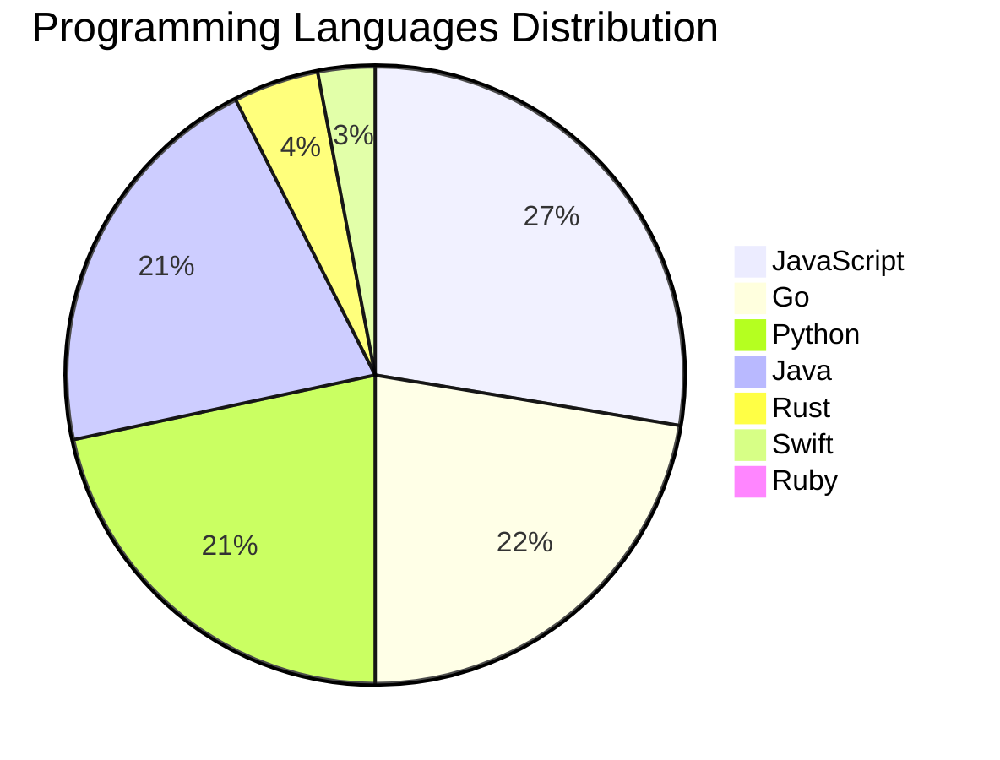

<div align="center">

# 📰 DevTech Auto News

**Your always-fresh digest of developer & AI tech news — curated automatically, around the clock.**


Aggregating [Dev.to](https://dev.to) · [Hacker News](https://news.ycombinator.com) · [GitHub Trending](https://github.com/trending) · [Lobste.rs](https://lobste.rs) · [Stack Overflow](https://stackoverflow.com) · [TechCrunch](https://techcrunch.com) · [freeCodeCamp](https://www.freecodecamp.org/news) — refreshed by GitHub Actions around the clock.

**[📰 Headlines](#-latest-headlines) · [💡 Interview Prep](#-interview-question-of-the-hour) · [📊 Statistics](#-statistics) · [⚙️ How It Works](#%EF%B8%8F-how-it-works)**

</div>

---

## 📰 Latest Headlines

> 🕐 Edition of **2026-10-15 11:00 CAT** — refreshed automatically, all day, every day.

### ✨ Featured Stories

<table>
<tr>
  <td align="center" width="33%">
    <a href="https://dev.to/jess/how-i-feel-about-the-grace-hopper-celebration-getting-cancelled-3l2k">
      
      <br/>
      <b>How I Feel about the Grace Hopper Celebration Gett...</b>
    </a>
    <br/>
    <sub>Dev.to</sub>
  </td>
  <td align="center" width="33%">
    <a href="https://dev.to/gde/requests-promises-assertions-and-declarations-rewriting-our-ai-agent-workflow-as-a-1986-4k4c">
      
      <br/>
      <b>Requests, Promises, Assertions, and Declarations: ...</b>
    </a>
    <br/>
    <sub>Dev.to</sub>
  </td>
  <td align="center" width="33%">
    <a href="https://dev.to/dailycontext/design-for-churn-5c6h">
      
      <br/>
      <b>Design for Churn</b>
    </a>
    <br/>
    <sub>Dev.to</sub>
  </td>
</tr>
<tr>
  <td align="center" width="33%">
    <a href="https://dev.to/dailycontext/are-you-smarter-than-a-fruit-fly-2c04">
      
      <br/>
      <b>Are You Smarter Than a Fruit Fly?</b>
    </a>
    <br/>
    <sub>Dev.to</sub>
  </td>
  <td align="center" width="33%">
    <a href="https://dev.to/dailycontext/building-better-agents-through-end-to-end-evals-pgh">
      
      <br/>
      <b>Building Better Agents through End-to-End Evals</b>
    </a>
    <br/>
    <sub>Dev.to</sub>
  </td>
  <td align="center" width="33%">
    <a href="https://dev.to/dailycontext/memory-isnt-learning-why-ai-agents-keep-making-the-same-mistakes-cpc">
      
      <br/>
      <b>Memory Isn’t Learning: Why AI Agents Keep Making t...</b>
    </a>
    <br/>
    <sub>Dev.to</sub>
  </td>
</tr>
</table>


### 🗞️ Top Stories

| # | Headline | Source |
|---|----------|--------|
| 1 | [How I Feel about the Grace Hopper Celebration Getting Cancelled](https://dev.to/jess/how-i-feel-about-the-grace-hopper-celebration-getting-cancelled-3l2k) | Dev.to |
| 2 | [Requests, Promises, Assertions, and Declarations: Rewriting Our AI Agent Workflow as a 1986 'Committed Speech' Machine](https://dev.to/gde/requests-promises-assertions-and-declarations-rewriting-our-ai-agent-workflow-as-a-1986-4k4c) | Dev.to |
| 3 | [Design for Churn](https://dev.to/dailycontext/design-for-churn-5c6h) | Dev.to |
| 4 | [Are You Smarter Than a Fruit Fly?](https://dev.to/dailycontext/are-you-smarter-than-a-fruit-fly-2c04) | Dev.to |
| 5 | [Building Better Agents through End-to-End Evals](https://dev.to/dailycontext/building-better-agents-through-end-to-end-evals-pgh) | Dev.to |
| 6 | [Memory Isn’t Learning: Why AI Agents Keep Making the Same Mistakes](https://dev.to/dailycontext/memory-isnt-learning-why-ai-agents-keep-making-the-same-mistakes-cpc) | Dev.to |
| 7 | [Your Financial Agent Passed Every Eval. Can You Defend Its Decision?](https://dev.to/dailycontext/your-financial-agent-passed-every-eval-can-you-defend-its-decision-1npg) | Dev.to |
| 8 | [The Model Is the Easy Part](https://dev.to/dailycontext/the-model-is-the-easy-part-19gh) | Dev.to |
| 9 | [An Agent’s Plan Isn’t Permission](https://dev.to/dailycontext/an-agents-plan-isnt-permission-5cf8) | Dev.to |
| 10 | [I Built a Cozy 60 FPS AI Agent Bakery Game to Teach RAG, Guardrails, Context Caching & Multi-Agent Orchestration](https://dev.to/gde/i-built-a-cozy-60-fps-ai-agent-bakery-game-to-teach-rag-guardrails-context-caching-multi-agent-2ek) | Dev.to |
| 11 | [Inside the $30-a-Week Self-Improving Agents Eliminating Enterprise Back-Office Friction](https://dev.to/dailycontext/inside-the-30-a-week-self-improving-agents-eliminating-enterprise-back-office-friction-c4p) | Dev.to |
| 12 | [The AI Data Paradox: The Safer You Make the Data, the Worse the AI Gets](https://dev.to/dailycontext/the-ai-data-paradox-the-safer-you-make-the-data-the-worse-the-ai-gets-1ek7) | Dev.to |
| 13 | [For Agents, Waiting is the Hardest Part](https://dev.to/dailycontext/for-agents-waiting-is-the-hardest-part-30ik) | Dev.to |
| 14 | [Beyond the Prompt Box: How Bloomberg is Architecting the Era of “Multiplayer AI”](https://dev.to/dailycontext/beyond-the-prompt-box-how-bloomberg-is-architecting-the-era-of-multiplayer-ai-569a) | Dev.to |
| 15 | [Nobody’s winning the AI race yet](https://dev.to/dailycontext/nobodys-winning-the-ai-race-yet-24h4) | Dev.to |
| 16 | [Operational intelligence is sociotechnical](https://dev.to/dailycontext/operational-intelligence-is-sociotechnical-1627) | Dev.to |
| 17 | [What a 48-Hour Hackathon Can Do for LLM Reliability](https://dev.to/dailycontext/what-a-48-hour-hackathon-can-do-for-llm-reliability-9j6) | Dev.to |
| 18 | [A Data Company in an AI World](https://dev.to/dailycontext/a-data-company-in-an-ai-world-5bf4) | Dev.to |
| 19 | [Where to Spend Your Week at AI Engineer New York](https://dev.to/dailycontext/where-to-spend-your-week-at-ai-engineer-new-york-3lg) | Dev.to |
| 20 | [Gemini 4 Under the Microscope: Red-Teaming AI Agents and Deterministic Dual-Port Remote Control Gemini 4 Architecture Banner](https://dev.to/gde/gemini-4-under-the-microscope-red-teaming-ai-agents-and-deterministic-dual-port-remote-control-4567) | Dev.to |

<sub>Last fetched: Thu, 15 Oct 2026 11:55:44 CAT</sub>


---

## 💡 Interview Question of the Hour

> Sharpen your skills — new questions selected on every update. Try answering before opening the hint!

**1. `Java` — What are Java Streams and how do they work?**

&nbsp;&nbsp;&nbsp;&nbsp;🎯 Medium · 🏷 functional programming, collections

<details>
<summary>&nbsp;&nbsp;&nbsp;&nbsp;💡 Show hint</summary>

> Lazy evaluation, pipeline, terminal operations

</details>

**2. `Python` — Explain decorators in Python with an example**

&nbsp;&nbsp;&nbsp;&nbsp;🎯 Medium · 🏷 functions, metaprogramming

<details>
<summary>&nbsp;&nbsp;&nbsp;&nbsp;💡 Show hint</summary>

> Function wrappers, @syntax, practical uses

</details>

**3. `SystemDesign` — How would you design a rate limiter?**

&nbsp;&nbsp;&nbsp;&nbsp;🎯 Medium · 🏷 system design, algorithms

<details>
<summary>&nbsp;&nbsp;&nbsp;&nbsp;💡 Show hint</summary>

> Token bucket, sliding window, distributed systems

</details>


---

## 📊 Statistics

#### 🗂 Articles by Category

| Category | Articles | Share | |
|----------|---------:|------:|---|
| **AI** | 90 | 48.9% | `████████████████████` |
| **Tools** | 39 | 21.2% | `█████████░░░░░░░░░░░` |
| **JavaScript** | 37 | 20.1% | `████████░░░░░░░░░░░░` |
| **Python** | 29 | 15.8% | `██████░░░░░░░░░░░░░░` |
| **Security** | 24 | 13.0% | `█████░░░░░░░░░░░░░░░` |
| **DevOps** | 14 | 7.6% | `███░░░░░░░░░░░░░░░░░` |
| **WebDev** | 8 | 4.3% | `██░░░░░░░░░░░░░░░░░░` |
| **Cloud** | 8 | 4.3% | `██░░░░░░░░░░░░░░░░░░` |
| **Mobile** | 6 | 3.3% | `█░░░░░░░░░░░░░░░░░░░` |
| **Database** | 5 | 2.7% | `█░░░░░░░░░░░░░░░░░░░` |

<sub>Articles can match more than one category, so shares may sum to over 100%.</sub>


#### 📡 Articles by Source

| Source | Articles |
|--------|---------:|
| Dev.to | 60 |
| HackerNews | 49 |
| GitHub | 25 |
| Lobste.rs | 10 |
| StackOverflow | 20 |
| TechCrunch | 10 |
| freeCodeCamp | 10 |


#### 💻 Programming Language Trends

```
JavaScript      ██████████████████████████████ 27.4%
Go              ████████████████████████ 22.2%
Python          ████████████████████████ 21.5%
Java            ███████████████████████ 20.7%
Rust            █████ 4.4%
Swift           ███ 3.0%
Ruby            █ 0.7%

```




#### 🏷 Trending Topics

            


---

## ⚙️ How It Works

This repository is a fully automated news pipeline. On every run, GitHub Actions:

1. **Fetches** the latest articles from seven sources: Dev.to, Hacker News, GitHub Trending, Lobste.rs, Stack Overflow, TechCrunch, and freeCodeCamp
2. **Deduplicates and categorizes** them across 10+ topics using keyword matching
3. **Extracts cover images** and computes language & category statistics
4. **Rebuilds this README** and appends everything to the [full archive](./data/news_log.md)
5. **Commits and pushes** the result — no human intervention needed

<details>
<summary><b>🚀 Run it yourself</b></summary>

```bash
git clone https://github.com/Derrick-MUGISHA/github-activity-bot.git
cd github-activity-bot
npm install
npm start
```

Fork the repo, enable GitHub Actions, and you have your own self-updating news feed.

</details>

<details>
<summary><b>📚 Data & resources</b></summary>

- [Full news archive](./data/news_log.md) — complete history of every fetched article
- [Statistics](./data/stats.json) — raw stats data (JSON)
- [Categorized articles](./data/categorized.json) — articles grouped by topic
- [Interview question bank](./data/interview_questions.json) — the full question set

</details>

---

## 🤝 Contributing

Ideas for new sources, categories, or interview questions are welcome — [open an issue](https://github.com/Derrick-MUGISHA/github-activity-bot/issues/new) or submit a pull request.

## 📄 License

Released under the [MIT License](https://opensource.org/licenses/MIT) — free to use, fork, and modify.

---

<div align="center">
  <sub>🤖 Last automated update: <b>Thu, 15 Oct 2026 09:55:44 GMT</b></sub><br/>
  <sub>Powered by GitHub Actions · Built with ❤️ by <a href="https://github.com/Derrick-MUGISHA">Derrick MUGISHA</a></sub>
</div>
