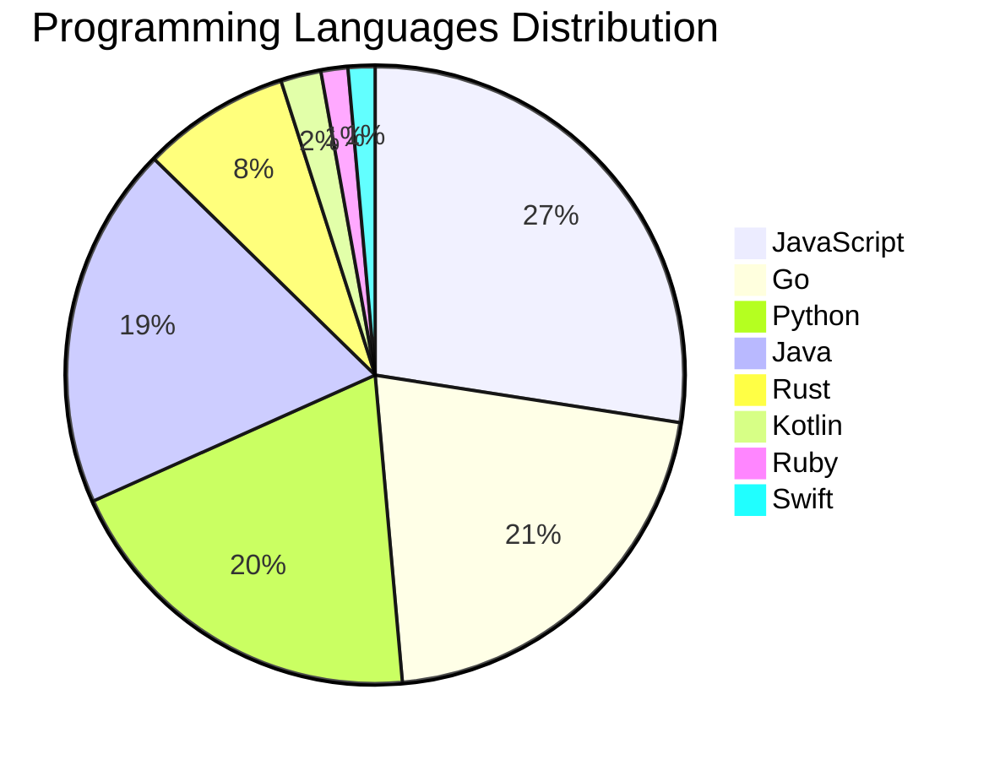

<div align="center">

# 📰 DevTech Auto News

**Your always-fresh digest of developer & AI tech news — curated automatically, around the clock.**


Aggregating [Dev.to](https://dev.to) · [Hacker News](https://news.ycombinator.com) · [GitHub Trending](https://github.com/trending) · [Lobste.rs](https://lobste.rs) · [Stack Overflow](https://stackoverflow.com) · [TechCrunch](https://techcrunch.com) · [freeCodeCamp](https://www.freecodecamp.org/news) — refreshed by GitHub Actions around the clock.

**[📰 Headlines](#-latest-headlines) · [💡 Interview Prep](#-interview-question-of-the-hour) · [📊 Statistics](#-statistics) · [⚙️ How It Works](#%EF%B8%8F-how-it-works)**

</div>

---

## 📰 Latest Headlines

> 🕐 Edition of **2026-11-13 17:00 CAT** — refreshed automatically, all day, every day.

### ✨ Featured Stories

<table>
<tr>
  <td align="center" width="33%">
    <a href="https://dev.to/ben/long-live-rails-3p21">
      
      <br/>
      <b>Long Live Rails</b>
    </a>
    <br/>
    <sub>Dev.to</sub>
  </td>
  <td align="center" width="33%">
    <a href="https://dev.to/annavi11arrea1/ultimate-ai-roast-168b">
      
      <br/>
      <b>Ultimate AI Roast! 😂😹</b>
    </a>
    <br/>
    <sub>Dev.to</sub>
  </td>
  <td align="center" width="33%">
    <a href="https://dev.to/maame-codes/how-did-you-end-up-in-tech-and-are-you-staying-4l9b">
      
      <br/>
      <b>How did you end up in tech, and are you staying?</b>
    </a>
    <br/>
    <sub>Dev.to</sub>
  </td>
</tr>
<tr>
  <td align="center" width="33%">
    <a href="https://dev.to/gde/six-serving-engines-on-four-accelerators-gemma-4-e2b-on-an-rtx-3050-a-t4-an-l4-and-a-tpu-v5e-1a0e">
      
      <br/>
      <b>Six Serving Engines on Four Accelerators: Gemma 4 ...</b>
    </a>
    <br/>
    <sub>Dev.to</sub>
  </td>
  <td align="center" width="33%">
    <a href="https://dev.to/thisisryanswift/make-the-most-of-your-hackathon-3914">
      
      <br/>
      <b>Make the most of your hackathon</b>
    </a>
    <br/>
    <sub>Dev.to</sub>
  </td>
  <td align="center" width="33%">
    <a href="https://dev.to/dailycontext/keeping-a-software-factory-stable-at-1000-prs-a-week-363j">
      
      <br/>
      <b>Keeping a software factory stable at 1,000 PRs a w...</b>
    </a>
    <br/>
    <sub>Dev.to</sub>
  </td>
</tr>
</table>


### 🗞️ Top Stories

| # | Headline | Source |
|---|----------|--------|
| 1 | [Long Live Rails](https://dev.to/ben/long-live-rails-3p21) | Dev.to |
| 2 | [Ultimate AI Roast! 😂😹](https://dev.to/annavi11arrea1/ultimate-ai-roast-168b) | Dev.to |
| 3 | [How did you end up in tech, and are you staying?](https://dev.to/maame-codes/how-did-you-end-up-in-tech-and-are-you-staying-4l9b) | Dev.to |
| 4 | [Six Serving Engines on Four Accelerators: Gemma 4 E2B on an RTX 3050, a T4, an L4 and a TPU v5e](https://dev.to/gde/six-serving-engines-on-four-accelerators-gemma-4-e2b-on-an-rtx-3050-a-t4-an-l4-and-a-tpu-v5e-1a0e) | Dev.to |
| 5 | [Make the most of your hackathon](https://dev.to/thisisryanswift/make-the-most-of-your-hackathon-3914) | Dev.to |
| 6 | [Keeping a software factory stable at 1,000 PRs a week](https://dev.to/dailycontext/keeping-a-software-factory-stable-at-1000-prs-a-week-363j) | Dev.to |
| 7 | [What was your win this week??](https://dev.to/devteam/what-was-your-win-this-week-4j49) | Dev.to |
| 8 | [From Prompt to Production: Building a Serverless Cloud Pipeline with Google Antigravity](https://dev.to/gdg/from-prompt-to-production-building-a-serverless-cloud-pipeline-with-google-antigravity-264l) | Dev.to |
| 9 | [️🎞️ What is native multimodality?](https://dev.to/googlecloud/what-is-native-multimodality-3091) | Dev.to |
| 10 | [What Changes With the A2UI 1.0 Release](https://dev.to/gde/what-changes-with-the-a2ui-10-release-31eo) | Dev.to |
| 11 | [The Jev Revolution: What Engineers Are Already Building with System One Models](https://dev.to/ricmac/the-jev-revolution-what-engineers-are-already-building-with-system-one-models-12p3) | Dev.to |
| 12 | [Refactor or Rot: Designing a Self-Improving Codebase](https://dev.to/jacob_prall_1c6bff06b0e0d/refactor-or-rot-designing-a-self-improving-codebase-22ak) | Dev.to |
| 13 | [AI Has Changed the Economics of Hacking: What Changes for Businesses After Black October](https://dev.to/dailycontext/ai-has-changed-the-economics-of-hacking-what-changes-for-businesses-after-black-october-5h4c) | Dev.to |
| 14 | [The Harness Doesn't Matter](https://dev.to/kartik_sarangmath/the-harness-doesnt-matter-4ggb) | Dev.to |
| 15 | [AI Coding Agents Need to Keep Their Promises](https://dev.to/jmccarthy/ai-coding-agents-need-to-keep-their-promises-2nhh) | Dev.to |
| 16 | [Can you merge at agent speed?](https://blog.mlh.com/can-you-merge-at-agent-speed-4m67) | Dev.to |
| 17 | [Why We Built an MCP Server for AI Founders’ Go to Market](https://dev.to/tedcarstensen/why-we-built-an-mcp-server-for-ai-founders-go-to-market-4hge) | Dev.to |
| 18 | [Nvidia Says Its Roadmap Will Continue. AI Teams Should Verify the Dependencies](https://dev.to/jamilxt/nvidia-says-its-roadmap-will-continue-ai-teams-should-verify-the-dependencies-3c8d) | Dev.to |
| 19 | [Fast multimodal control flow with the Gemini Decisions API](https://dev.to/philschmid/fast-multimodal-control-flow-with-the-gemini-decisions-api-533b) | Dev.to |
| 20 | [Use your eval as a CI gate with Agents CLI](https://dev.to/googlecloud/use-your-eval-as-a-ci-gate-with-agents-cli-1ha1) | Dev.to |

<sub>Last fetched: Fri, 13 Nov 2026 17:34:04 CAT</sub>


---

## 💡 Interview Question of the Hour

> Sharpen your skills — new questions selected on every update. Try answering before opening the hint!

**1. `Java` — Explain the Java memory model**

&nbsp;&nbsp;&nbsp;&nbsp;🎯 Hard · 🏷 memory, JVM

<details>
<summary>&nbsp;&nbsp;&nbsp;&nbsp;💡 Show hint</summary>

> Heap, stack, garbage collection

</details>

**2. `Database` — What is database normalization and denormalization?**

&nbsp;&nbsp;&nbsp;&nbsp;🎯 Medium · 🏷 design, optimization

<details>
<summary>&nbsp;&nbsp;&nbsp;&nbsp;💡 Show hint</summary>

> Normal forms, redundancy, performance trade-offs

</details>

**3. `Python` — Implement a context manager using __enter__ and __exit__**

&nbsp;&nbsp;&nbsp;&nbsp;🎯 Hard · 🏷 context managers, resource management

<details>
<summary>&nbsp;&nbsp;&nbsp;&nbsp;💡 Show hint</summary>

> with statement, setup/teardown, exception handling

</details>


---

## 📊 Statistics

#### 🗂 Articles by Category

| Category | Articles | Share | |
|----------|---------:|------:|---|
| **AI** | 88 | 47.8% | `████████████████████` |
| **Tools** | 43 | 23.4% | `██████████░░░░░░░░░░` |
| **JavaScript** | 39 | 21.2% | `█████████░░░░░░░░░░░` |
| **Python** | 28 | 15.2% | `██████░░░░░░░░░░░░░░` |
| **Security** | 19 | 10.3% | `████░░░░░░░░░░░░░░░░` |
| **Cloud** | 17 | 9.2% | `████░░░░░░░░░░░░░░░░` |
| **DevOps** | 16 | 8.7% | `████░░░░░░░░░░░░░░░░` |
| **WebDev** | 10 | 5.4% | `██░░░░░░░░░░░░░░░░░░` |
| **Mobile** | 7 | 3.8% | `██░░░░░░░░░░░░░░░░░░` |
| **Database** | 3 | 1.6% | `█░░░░░░░░░░░░░░░░░░░` |

<sub>Articles can match more than one category, so shares may sum to over 100%.</sub>


#### 📡 Articles by Source

| Source | Articles |
|--------|---------:|
| Dev.to | 60 |
| HackerNews | 49 |
| GitHub | 25 |
| Lobste.rs | 10 |
| StackOverflow | 20 |
| TechCrunch | 10 |
| freeCodeCamp | 10 |


#### 💻 Programming Language Trends

```
JavaScript      ██████████████████████████████ 27.5%
Go              ███████████████████████ 21.1%
Python          █████████████████████ 19.7%
Java            █████████████████████ 19.0%
Rust            ████████ 7.7%
Kotlin          ██ 2.1%
Ruby            ██ 1.4%
Swift           ██ 1.4%

```




#### 🏷 Trending Topics

            


---

## ⚙️ How It Works

This repository is a fully automated news pipeline. On every run, GitHub Actions:

1. **Fetches** the latest articles from seven sources: Dev.to, Hacker News, GitHub Trending, Lobste.rs, Stack Overflow, TechCrunch, and freeCodeCamp
2. **Deduplicates and categorizes** them across 10+ topics using keyword matching
3. **Extracts cover images** and computes language & category statistics
4. **Rebuilds this README** and appends everything to the [full archive](./data/news_log.md)
5. **Commits and pushes** the result — no human intervention needed

<details>
<summary><b>🚀 Run it yourself</b></summary>

```bash
git clone https://github.com/Derrick-MUGISHA/github-activity-bot.git
cd github-activity-bot
npm install
npm start
```

Fork the repo, enable GitHub Actions, and you have your own self-updating news feed.

</details>

<details>
<summary><b>📚 Data & resources</b></summary>

- [Full news archive](./data/news_log.md) — complete history of every fetched article
- [Statistics](./data/stats.json) — raw stats data (JSON)
- [Categorized articles](./data/categorized.json) — articles grouped by topic
- [Interview question bank](./data/interview_questions.json) — the full question set

</details>

---

## 🤝 Contributing

Ideas for new sources, categories, or interview questions are welcome — [open an issue](https://github.com/Derrick-MUGISHA/github-activity-bot/issues/new) or submit a pull request.

## 📄 License

Released under the [MIT License](https://opensource.org/licenses/MIT) — free to use, fork, and modify.

---

<div align="center">
  <sub>🤖 Last automated update: <b>Fri, 13 Nov 2026 15:34:04 GMT</b></sub><br/>
  <sub>Powered by GitHub Actions · Built with ❤️ by <a href="https://github.com/Derrick-MUGISHA">Derrick MUGISHA</a></sub>
</div>
