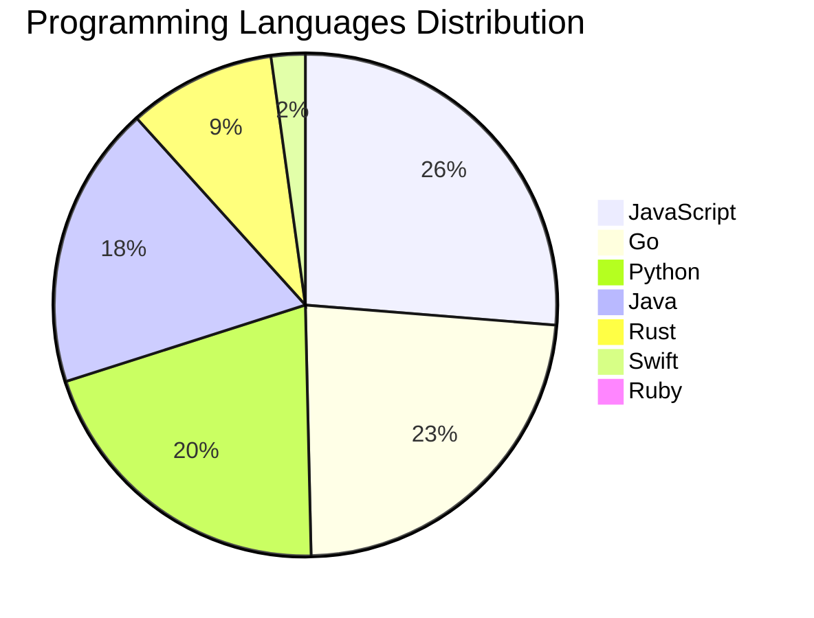

<div align="center">

# 📰 DevTech Auto News

**Your always-fresh digest of developer & AI tech news — curated automatically, around the clock.**


Aggregating [Dev.to](https://dev.to) · [Hacker News](https://news.ycombinator.com) · [GitHub Trending](https://github.com/trending) · [Lobste.rs](https://lobste.rs) · [Stack Overflow](https://stackoverflow.com) · [TechCrunch](https://techcrunch.com) · [freeCodeCamp](https://www.freecodecamp.org/news) — refreshed by GitHub Actions around the clock.

**[📰 Headlines](#-latest-headlines) · [💡 Interview Prep](#-interview-question-of-the-hour) · [📊 Statistics](#-statistics) · [⚙️ How It Works](#%EF%B8%8F-how-it-works)**

</div>

---

## 📰 Latest Headlines

> 🕐 Edition of **2026-11-05 20:00 CAT** — refreshed automatically, all day, every day.

### ✨ Featured Stories

<table>
<tr>
  <td align="center" width="33%">
    <a href="https://dev.to/maame-codes/lets-see-where-you-code-147">
      
      <br/>
      <b>Let's see where you code!</b>
    </a>
    <br/>
    <sub>Dev.to</sub>
  </td>
  <td align="center" width="33%">
    <a href="https://dev.to/googlecloud/find-the-production-agent-failures-that-every-health-check-misses-39j8">
      
      <br/>
      <b>Find the production agent failures that every heal...</b>
    </a>
    <br/>
    <sub>Dev.to</sub>
  </td>
  <td align="center" width="33%">
    <a href="https://dev.to/devteam/thats-a-wrap-on-hacktoberfest-2026-148k">
      
      <br/>
      <b>That's a Wrap on Hacktoberfest 2026! 🎃👻</b>
    </a>
    <br/>
    <sub>Dev.to</sub>
  </td>
</tr>
<tr>
  <td align="center" width="33%">
    <a href="https://dev.to/ben/thank-you-to-everyone-who-pointed-out-the-phishing-posts-we-got-yesterday-were-working-on-1h9b">
      
      <br/>
      <b>Thank you to everyone who pointed out the phishing...</b>
    </a>
    <br/>
    <sub>Dev.to</sub>
  </td>
  <td align="center" width="33%">
    <a href="https://dev.to/gde/gemma-4-e2b-in-jax-on-one-tpu-v5e-bf16-or-4-bit-python-or-rust-and-how-it-stands-against-vllm-j72">
      
      <br/>
      <b>Gemma 4 E2B in JAX on One TPU v5e: bf16 or 4-Bit, ...</b>
    </a>
    <br/>
    <sub>Dev.to</sub>
  </td>
  <td align="center" width="33%">
    <a href="https://dev.to/gde/securing-an-angular-firebase-ai-app-with-emailpassword-authentication-part-3-lightweight-home-17dg">
      
      <br/>
      <b>Securing an Angular Firebase AI App with Email/Pas...</b>
    </a>
    <br/>
    <sub>Dev.to</sub>
  </td>
</tr>
</table>


### 🗞️ Top Stories

| # | Headline | Source |
|---|----------|--------|
| 1 | [Let's see where you code!](https://dev.to/maame-codes/lets-see-where-you-code-147) | Dev.to |
| 2 | [Find the production agent failures that every health check misses](https://dev.to/googlecloud/find-the-production-agent-failures-that-every-health-check-misses-39j8) | Dev.to |
| 3 | [That's a Wrap on Hacktoberfest 2026! 🎃👻](https://dev.to/devteam/thats-a-wrap-on-hacktoberfest-2026-148k) | Dev.to |
| 4 | [Thank you to everyone who pointed out the phishing posts we got yesterday. We're working on improved mechanisms to automatically reject those types of attacks.](https://dev.to/ben/thank-you-to-everyone-who-pointed-out-the-phishing-posts-we-got-yesterday-were-working-on-1h9b) | Dev.to |
| 5 | [Gemma 4 E2B in JAX on One TPU v5e: bf16 or 4-Bit, Python or Rust, and How It Stands Against vLLM](https://dev.to/gde/gemma-4-e2b-in-jax-on-one-tpu-v5e-bf16-or-4-bit-python-or-rust-and-how-it-stands-against-vllm-j72) | Dev.to |
| 6 | [Securing an Angular Firebase AI App with Email/Password Authentication (Part 3: Lightweight Home Screen, Lazy CDK Dialog, and Header Navigation)](https://dev.to/gde/securing-an-angular-firebase-ai-app-with-emailpassword-authentication-part-3-lightweight-home-17dg) | Dev.to |
| 7 | [Leveling the Playing Field: Building a 100% Offline Kubernetes Docs RAG Exam Assistant with Web AI, Gemma 4, and WebGPU](https://dev.to/gde/leveling-the-playing-field-building-a-100-offline-kubernetes-docs-rag-exam-assistant-with-web-ai-53bi) | Dev.to |
| 8 | [What I Learned Managing a Full Project with Antigravity](https://dev.to/gde/what-i-learned-managing-a-full-project-with-antigravity-1ppc) | Dev.to |
| 9 | [Join the Presage SmartSpectra SDK Challenge: $3,000 in Prizes Across 10 Winners!](https://dev.to/devteam/join-the-presage-smartspectra-sdk-challenge-3000-in-prizes-across-10-winners-1370) | Dev.to |
| 10 | [Prompt Pad: What Is Open Source?](https://blog.mlh.com/prompt-pad-what-is-open-source-23k6) | Dev.to |
| 11 | [Prompt Pad: Frame Your Persona for Better AI Answers](https://blog.mlh.com/prompt-pad-frame-your-persona-for-better-ai-answers-eg3) | Dev.to |
| 12 | [Securing an Angular Firebase AI App with Email/Password Authentication (Part 2: Signal Forms Sign-In Modal) [GDE]](https://dev.to/gde/securing-an-angular-firebase-ai-app-with-emailpassword-authentication-part-2-signal-forms-3ll9) | Dev.to |
| 13 | [Prompt Pad: Lock Your AI's Output Schema in Google AI Studio](https://blog.mlh.com/prompt-pad-lock-your-ais-output-schema-in-google-ai-studio-53io) | Dev.to |
| 14 | [Gemma 4 in Rust on TorchTPU: Hands On With Colab](https://dev.to/gde/gemma-4-in-rust-on-torchtpu-hands-on-with-colab-44hi) | Dev.to |
| 15 | [The Postcard That Ate Six Grammars: 1980 Smalltalk-80, 1976 Make, TDD, and the Four Attractors of Agentic Coding](https://dev.to/gde/the-postcard-that-ate-six-grammars-1980-smalltalk-80-1976-make-tdd-and-the-four-attractors-of-45me) | Dev.to |
| 16 | [Profile Sprawl: Solving a Problem You Didn't Know You Had](https://dev.to/gde/profile-sprawl-solving-a-problem-you-didnt-know-you-had-19k5) | Dev.to |
| 17 | [[Agent Platform in Action (7)] When ADK Go Graph Workflow Meets Google Research Harness (Part 1): Two-Layer Recursive Agent Fram](https://dev.to/gde/agent-platform-in-action-7-when-adk-go-graph-workflow-meets-google-research-harness-part-1-28c1) | Dev.to |
| 18 | [From `main.js` Leaks to Hidden Tailwind CSS v4 Bloat — How I Built `angular-bundle-guard` with Antigravity `/learn` [GDE]](https://dev.to/gde/from-mainjs-leaks-to-hidden-tailwind-css-v4-bloat-how-i-built-angular-bundle-guard-with-geg) | Dev.to |
| 19 | [Welcome Thread - v400](https://dev.to/sloan/welcome-thread-v400-2e8m) | Dev.to |
| 20 | [The A2A CLI and Rust: The Same Code, Three Ways to Serve It](https://dev.to/gde/the-a2a-cli-and-rust-the-same-code-three-ways-to-serve-it-4el0) | Dev.to |

<sub>Last fetched: Thu, 05 Nov 2026 20:00:20 CAT</sub>


---

## 💡 Interview Question of the Hour

> Sharpen your skills — new questions selected on every update. Try answering before opening the hint!

**1. `SystemDesign` — Design Twitter's timeline feature**

&nbsp;&nbsp;&nbsp;&nbsp;🎯 Hard · 🏷 system design, scalability

<details>
<summary>&nbsp;&nbsp;&nbsp;&nbsp;💡 Show hint</summary>

> Fan-out, caching, ranking, real-time updates

</details>

**2. `JavaScript` — Explain event delegation and why it's useful**

&nbsp;&nbsp;&nbsp;&nbsp;🎯 Medium · 🏷 events, DOM

<details>
<summary>&nbsp;&nbsp;&nbsp;&nbsp;💡 Show hint</summary>

> Event bubbling, single listener for multiple elements

</details>

**3. `JavaScript` — Explain event delegation and why it's useful**

&nbsp;&nbsp;&nbsp;&nbsp;🎯 Medium · 🏷 events, DOM

<details>
<summary>&nbsp;&nbsp;&nbsp;&nbsp;💡 Show hint</summary>

> Event bubbling, single listener for multiple elements

</details>


---

## 📊 Statistics

#### 🗂 Articles by Category

| Category | Articles | Share | |
|----------|---------:|------:|---|
| **AI** | 77 | 41.8% | `████████████████████` |
| **Tools** | 37 | 20.1% | `██████████░░░░░░░░░░` |
| **JavaScript** | 36 | 19.6% | `█████████░░░░░░░░░░░` |
| **Python** | 29 | 15.8% | `████████░░░░░░░░░░░░` |
| **Security** | 19 | 10.3% | `█████░░░░░░░░░░░░░░░` |
| **DevOps** | 18 | 9.8% | `█████░░░░░░░░░░░░░░░` |
| **Cloud** | 14 | 7.6% | `████░░░░░░░░░░░░░░░░` |
| **Database** | 9 | 4.9% | `██░░░░░░░░░░░░░░░░░░` |
| **WebDev** | 8 | 4.3% | `██░░░░░░░░░░░░░░░░░░` |
| **Mobile** | 6 | 3.3% | `██░░░░░░░░░░░░░░░░░░` |

<sub>Articles can match more than one category, so shares may sum to over 100%.</sub>


#### 📡 Articles by Source

| Source | Articles |
|--------|---------:|
| Dev.to | 60 |
| HackerNews | 49 |
| GitHub | 25 |
| Lobste.rs | 10 |
| StackOverflow | 20 |
| TechCrunch | 10 |
| freeCodeCamp | 10 |


#### 💻 Programming Language Trends

```
JavaScript      ██████████████████████████████ 26.1%
Go              ███████████████████████████ 23.2%
Python          ███████████████████████ 20.3%
Java            █████████████████████ 18.1%
Rust            ███████████ 9.4%
Swift           ███ 2.2%
Ruby            █ 0.7%

```




#### 🏷 Trending Topics

            


---

## ⚙️ How It Works

This repository is a fully automated news pipeline. On every run, GitHub Actions:

1. **Fetches** the latest articles from seven sources: Dev.to, Hacker News, GitHub Trending, Lobste.rs, Stack Overflow, TechCrunch, and freeCodeCamp
2. **Deduplicates and categorizes** them across 10+ topics using keyword matching
3. **Extracts cover images** and computes language & category statistics
4. **Rebuilds this README** and appends everything to the [full archive](./data/news_log.md)
5. **Commits and pushes** the result — no human intervention needed

<details>
<summary><b>🚀 Run it yourself</b></summary>

```bash
git clone https://github.com/Derrick-MUGISHA/github-activity-bot.git
cd github-activity-bot
npm install
npm start
```

Fork the repo, enable GitHub Actions, and you have your own self-updating news feed.

</details>

<details>
<summary><b>📚 Data & resources</b></summary>

- [Full news archive](./data/news_log.md) — complete history of every fetched article
- [Statistics](./data/stats.json) — raw stats data (JSON)
- [Categorized articles](./data/categorized.json) — articles grouped by topic
- [Interview question bank](./data/interview_questions.json) — the full question set

</details>

---

## 🤝 Contributing

Ideas for new sources, categories, or interview questions are welcome — [open an issue](https://github.com/Derrick-MUGISHA/github-activity-bot/issues/new) or submit a pull request.

## 📄 License

Released under the [MIT License](https://opensource.org/licenses/MIT) — free to use, fork, and modify.

---

<div align="center">
  <sub>🤖 Last automated update: <b>Thu, 05 Nov 2026 18:00:20 GMT</b></sub><br/>
  <sub>Powered by GitHub Actions · Built with ❤️ by <a href="https://github.com/Derrick-MUGISHA">Derrick MUGISHA</a></sub>
</div>
