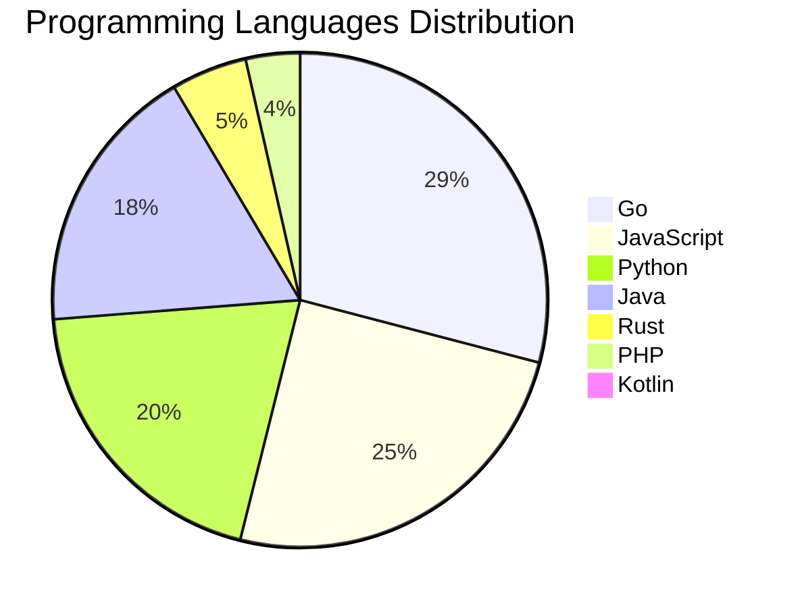

<div align="center">

# 📰 DevTech Auto News

**Your always-fresh digest of developer & AI tech news — curated automatically, around the clock.**


Aggregating [Dev.to](https://dev.to) · [Hacker News](https://news.ycombinator.com) · [GitHub Trending](https://github.com/trending) · [Lobste.rs](https://lobste.rs) · [Stack Overflow](https://stackoverflow.com) · [TechCrunch](https://techcrunch.com) · [freeCodeCamp](https://www.freecodecamp.org/news) — refreshed by GitHub Actions around the clock.

**[📰 Headlines](#-latest-headlines) · [💡 Interview Prep](#-interview-question-of-the-hour) · [📊 Statistics](#-statistics) · [⚙️ How It Works](#%EF%B8%8F-how-it-works)**

</div>

---

## 📰 Latest Headlines

> 🕐 Edition of **2026-10-23 17:00 CAT** — refreshed automatically, all day, every day.

### ✨ Featured Stories

<table>
<tr>
  <td align="center" width="33%">
    <a href="https://dev.to/adamthedeveloper/dont-be-a-proxy-between-me-and-your-ai-mcn">
      
      <br/>
      <b>Don't Be a Proxy Between Me and Your AI</b>
    </a>
    <br/>
    <sub>Dev.to</sub>
  </td>
  <td align="center" width="33%">
    <a href="https://dev.to/pahorton/i-got-tired-of-coming-into-my-lab-to-check-the-pressure-of-my-cryocooler-so-i-built-a-tool-to-do-it-4ob7">
      
      <br/>
      <b>I Got Tired of Coming Into My Lab To Check the Pre...</b>
    </a>
    <br/>
    <sub>Dev.to</sub>
  </td>
  <td align="center" width="33%">
    <a href="https://dev.to/gde/comic-studio-ai-turning-voice-text-prompts-into-4-panel-comics-with-google-ai-studio-gemini--2npc">
      
      <br/>
      <b>Comic Studio AI: Turning Voice & Text Prompts into...</b>
    </a>
    <br/>
    <sub>Dev.to</sub>
  </td>
</tr>
<tr>
  <td align="center" width="33%">
    <a href="https://dev.to/gde/926-steps-two-lobotomies-and-zero-nudges-flight-testing-the-commitment-machine-across-gemini-55ca">
      
      <br/>
      <b>926 Steps, Two Lobotomies, and Zero Nudges: Flight...</b>
    </a>
    <br/>
    <sub>Dev.to</sub>
  </td>
  <td align="center" width="33%">
    <a href="https://dev.to/gde/building-a-multimodal-suggestion-based-ai-writing-coach-with-gemini-and-google-docs-ea4">
      
      <br/>
      <b>Building a Multimodal, Suggestion-Based AI Writing...</b>
    </a>
    <br/>
    <sub>Dev.to</sub>
  </td>
  <td align="center" width="33%">
    <a href="https://dev.to/devteam/what-was-your-win-this-week-4ipe">
      
      <br/>
      <b>What was your win this week!?</b>
    </a>
    <br/>
    <sub>Dev.to</sub>
  </td>
</tr>
</table>


### 🗞️ Top Stories

| # | Headline | Source |
|---|----------|--------|
| 1 | [Don't Be a Proxy Between Me and Your AI](https://dev.to/adamthedeveloper/dont-be-a-proxy-between-me-and-your-ai-mcn) | Dev.to |
| 2 | [I Got Tired of Coming Into My Lab To Check the Pressure of My Cryocooler so I Built a Tool To Do It for Me](https://dev.to/pahorton/i-got-tired-of-coming-into-my-lab-to-check-the-pressure-of-my-cryocooler-so-i-built-a-tool-to-do-it-4ob7) | Dev.to |
| 3 | [Comic Studio AI: Turning Voice & Text Prompts into 4-Panel Comics with Google AI Studio, Gemini & Imagen](https://dev.to/gde/comic-studio-ai-turning-voice-text-prompts-into-4-panel-comics-with-google-ai-studio-gemini--2npc) | Dev.to |
| 4 | [926 Steps, Two Lobotomies, and Zero Nudges: Flight-Testing the Commitment Machine Across Gemini, Claude, and GPT-OSS](https://dev.to/gde/926-steps-two-lobotomies-and-zero-nudges-flight-testing-the-commitment-machine-across-gemini-55ca) | Dev.to |
| 5 | [Building a Multimodal, Suggestion-Based AI Writing Coach with Gemini and Google Docs](https://dev.to/gde/building-a-multimodal-suggestion-based-ai-writing-coach-with-gemini-and-google-docs-ea4) | Dev.to |
| 6 | [What was your win this week!?](https://dev.to/devteam/what-was-your-win-this-week-4ipe) | Dev.to |
| 7 | [SlothSRE (NapOps): An Overnight Gemma 4 & ADK Agent That Compresses 418 Lines of 3 AM Alerts into a 2-Line Morning Digest](https://dev.to/gde/slothsre-napops-an-overnight-gemma-4-adk-agent-that-compresses-418-lines-of-3-am-alerts-into-a-1pk6) | Dev.to |
| 8 | [Promise Delivered: Welcome to the DEV Hall of Fame (65 Authors, 65 Masterpieces)](https://dev.to/georgekobaidze/promise-delivered-welcome-to-the-dev-hall-of-fame-65-authors-65-masterpieces-15fa) | Dev.to |
| 9 | [Building a Cross-Model Collaborative Workflow with Google Antigravity](https://dev.to/gde/building-a-cross-model-collaborative-workflow-with-google-antigravity-2jj5) | Dev.to |
| 10 | [Building a Multi-Agent Token Usage Widget in Under 500 KB](https://dev.to/gde/building-a-multi-agent-token-usage-widget-in-under-500-kb-1fih) | Dev.to |
| 11 | [Scaling stateful Gemini 4 Argon agent sessions on GKE: Connection draining, startup boost, and session persistence](https://dev.to/googlecloud/scaling-stateful-gemini-4-argon-agent-sessions-on-gke-connection-draining-startup-boost-and-13ln) | Dev.to |
| 12 | [Congrats to the Sanity Challenge Winners!](https://dev.to/devteam/congrats-to-the-sanity-challenge-winners-1140) | Dev.to |
| 13 | [Natural Languages Have Design Trade-offs Too: Georgian Is Dynamically Typed, English Is Statically Typed](https://dev.to/georgekobaidze/natural-languages-have-design-trade-offs-too-georgian-is-dynamically-typed-english-is-statically-emi) | Dev.to |
| 14 | [Automated incident triage on GKE with Gemini 4 Argon and Model Context Protocol: Correlating cluster events and VPA logs](https://dev.to/googlecloud/automated-incident-triage-on-gke-with-gemini-4-argon-and-model-context-protocol-correlating-24eb) | Dev.to |
| 15 | [Generative UI Without the Async Tax: Introducing bloc_signals_genui 1.0](https://dev.to/gde/generative-ui-without-the-async-tax-introducing-blocsignalsgenui-10-3gge) | Dev.to |
| 16 | [Two ways to build with Claude models on Google Cloud!](https://dev.to/googleai/two-ways-to-build-with-claude-models-on-google-cloud-1mfe) | Dev.to |
| 17 | [Building ora-tui with Google Antigravity & Gemini 4 Argon: An MS-DOS Retro TUI & OpenTelemetry Exporter for Oracle RAC, DB & SAN Multipath](https://dev.to/gde/building-ora-tui-with-google-antigravity-gemini-4-argon-an-ms-dos-retro-tui-opentelemetry-4d02) | Dev.to |
| 18 | [DuckLess: serverless DuckDB on Google Cloud, in your own project](https://dev.to/gde/duckless-serverless-duckdb-on-google-cloud-in-your-own-project-4o5a) | Dev.to |
| 19 | [Autonomous agent loops with Gemini 4 Argon and GKE Agent Sandbox: Running untrusted code safely at scale](https://dev.to/googlecloud/autonomous-agent-loops-with-gemini-4-argon-and-gke-agent-sandbox-running-untrusted-code-safely-at-2k60) | Dev.to |
| 20 | [How I Feel about the Grace Hopper Celebration Getting Cancelled](https://dev.to/jess/how-i-feel-about-the-grace-hopper-celebration-getting-cancelled-3l2k) | Dev.to |

<sub>Last fetched: Fri, 23 Oct 2026 17:55:19 CAT</sub>


---

## 💡 Interview Question of the Hour

> Sharpen your skills — new questions selected on every update. Try answering before opening the hint!

**1. `SystemDesign` — Design a distributed cache system**

&nbsp;&nbsp;&nbsp;&nbsp;🎯 Hard · 🏷 distributed systems, caching

<details>
<summary>&nbsp;&nbsp;&nbsp;&nbsp;💡 Show hint</summary>

> Consistency, partitioning, replication, eviction policies

</details>

**2. `NodeJS` — What is the difference between process.nextTick() and setImmediate()?**

&nbsp;&nbsp;&nbsp;&nbsp;🎯 Medium · 🏷 event loop, async

<details>
<summary>&nbsp;&nbsp;&nbsp;&nbsp;💡 Show hint</summary>

> Execution timing, event loop phases

</details>

**3. `Database` — Design a database schema for a social media platform**

&nbsp;&nbsp;&nbsp;&nbsp;🎯 Hard · 🏷 design, scalability

<details>
<summary>&nbsp;&nbsp;&nbsp;&nbsp;💡 Show hint</summary>

> Users, posts, relationships, indexes, partitioning

</details>


---

## 📊 Statistics

#### 🗂 Articles by Category

| Category | Articles | Share | |
|----------|---------:|------:|---|
| **AI** | 75 | 40.8% | `████████████████████` |
| **Tools** | 44 | 23.9% | `████████████░░░░░░░░` |
| **JavaScript** | 35 | 19.0% | `█████████░░░░░░░░░░░` |
| **Python** | 28 | 15.2% | `███████░░░░░░░░░░░░░` |
| **DevOps** | 17 | 9.2% | `█████░░░░░░░░░░░░░░░` |
| **Security** | 16 | 8.7% | `████░░░░░░░░░░░░░░░░` |
| **Cloud** | 15 | 8.2% | `████░░░░░░░░░░░░░░░░` |
| **WebDev** | 9 | 4.9% | `██░░░░░░░░░░░░░░░░░░` |
| **Database** | 7 | 3.8% | `██░░░░░░░░░░░░░░░░░░` |
| **Mobile** | 4 | 2.2% | `█░░░░░░░░░░░░░░░░░░░` |

<sub>Articles can match more than one category, so shares may sum to over 100%.</sub>


#### 📡 Articles by Source

| Source | Articles |
|--------|---------:|
| Dev.to | 60 |
| HackerNews | 49 |
| GitHub | 25 |
| Lobste.rs | 10 |
| StackOverflow | 20 |
| TechCrunch | 10 |
| freeCodeCamp | 10 |


#### 💻 Programming Language Trends

```
Go              ██████████████████████████████ 28.9%
JavaScript      ██████████████████████████ 24.6%
Python          ████████████████████ 19.7%
Java            ██████████████████ 17.6%
Rust            █████ 4.9%
PHP             ████ 3.5%
Kotlin          █ 0.7%

```




#### 🏷 Trending Topics

            


---

## ⚙️ How It Works

This repository is a fully automated news pipeline. On every run, GitHub Actions:

1. **Fetches** the latest articles from seven sources: Dev.to, Hacker News, GitHub Trending, Lobste.rs, Stack Overflow, TechCrunch, and freeCodeCamp
2. **Deduplicates and categorizes** them across 10+ topics using keyword matching
3. **Extracts cover images** and computes language & category statistics
4. **Rebuilds this README** and appends everything to the [full archive](./data/news_log.md)
5. **Commits and pushes** the result — no human intervention needed

<details>
<summary><b>🚀 Run it yourself</b></summary>

```bash
git clone https://github.com/Derrick-MUGISHA/github-activity-bot.git
cd github-activity-bot
npm install
npm start
```

Fork the repo, enable GitHub Actions, and you have your own self-updating news feed.

</details>

<details>
<summary><b>📚 Data & resources</b></summary>

- [Full news archive](./data/news_log.md) — complete history of every fetched article
- [Statistics](./data/stats.json) — raw stats data (JSON)
- [Categorized articles](./data/categorized.json) — articles grouped by topic
- [Interview question bank](./data/interview_questions.json) — the full question set

</details>

---

## 🤝 Contributing

Ideas for new sources, categories, or interview questions are welcome — [open an issue](https://github.com/Derrick-MUGISHA/github-activity-bot/issues/new) or submit a pull request.

## 📄 License

Released under the [MIT License](https://opensource.org/licenses/MIT) — free to use, fork, and modify.

---

<div align="center">
  <sub>🤖 Last automated update: <b>Fri, 23 Oct 2026 15:55:19 GMT</b></sub><br/>
  <sub>Powered by GitHub Actions · Built with ❤️ by <a href="https://github.com/Derrick-MUGISHA">Derrick MUGISHA</a></sub>
</div>
