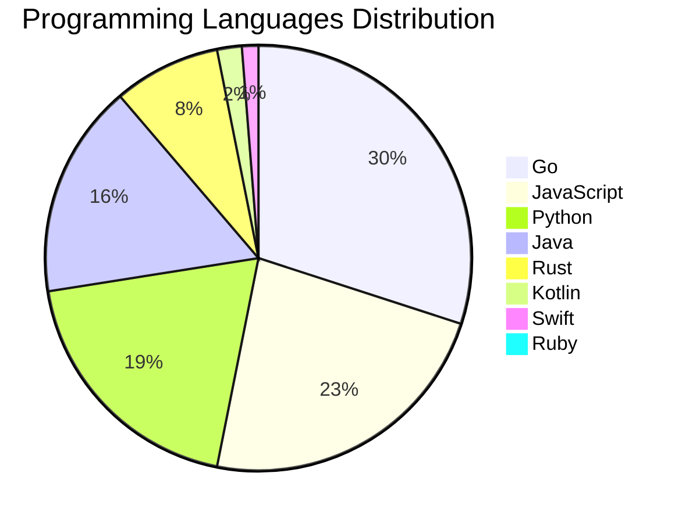

<div align="center">

# 📰 DevTech Auto News

**Your always-fresh digest of developer & AI tech news — curated automatically, around the clock.**


Aggregating [Dev.to](https://dev.to) · [Hacker News](https://news.ycombinator.com) · [GitHub Trending](https://github.com/trending) · [Lobste.rs](https://lobste.rs) · [Stack Overflow](https://stackoverflow.com) · [TechCrunch](https://techcrunch.com) · [freeCodeCamp](https://www.freecodecamp.org/news) — refreshed by GitHub Actions around the clock.

**[📰 Headlines](#-latest-headlines) · [💡 Interview Prep](#-interview-question-of-the-hour) · [📊 Statistics](#-statistics) · [⚙️ How It Works](#%EF%B8%8F-how-it-works)**

</div>

---

## 📰 Latest Headlines

> 🕐 Edition of **2026-11-11 10:00 CAT** — refreshed automatically, all day, every day.

### ✨ Featured Stories

<table>
<tr>
  <td align="center" width="33%">
    <a href="https://dev.to/maame-codes/how-did-you-end-up-in-tech-and-are-you-staying-4l9b">
      
      <br/>
      <b>How did you end up in tech, and are you staying?</b>
    </a>
    <br/>
    <sub>Dev.to</sub>
  </td>
  <td align="center" width="33%">
    <a href="https://dev.to/devteam/top-7-featured-dev-posts-of-the-week-432g">
      
      <br/>
      <b>Top 7 Featured DEV Posts of the Week</b>
    </a>
    <br/>
    <sub>Dev.to</sub>
  </td>
  <td align="center" width="33%">
    <a href="https://dev.to/gde/stop-asking-llms-to-do-math-client-side-functions-in-flutter-genui-with-blocsignals-23bh">
      
      <br/>
      <b>Stop Asking LLMs to Do Math: Client-Side Functions...</b>
    </a>
    <br/>
    <sub>Dev.to</sub>
  </td>
</tr>
<tr>
  <td align="center" width="33%">
    <a href="https://blog.mlh.com/prompt-pad-what-are-open-weight-models-1ghh">
      
      <br/>
      <b>Prompt Pad: What Are Open-Weight Models?</b>
    </a>
    <br/>
    <sub>Dev.to</sub>
  </td>
  <td align="center" width="33%">
    <a href="https://dev.to/gde/what-i-learned-managing-a-full-project-with-antigravity-1ppc">
      
      <br/>
      <b>What I Learned Managing a Full Project with Antigr...</b>
    </a>
    <br/>
    <sub>Dev.to</sub>
  </td>
  <td align="center" width="33%">
    <a href="https://dev.to/gde/containing-the-autonomous-mind-sub-second-zero-trust-execution-with-gke-agent-sandbox-5e6b">
      
      <br/>
      <b>Containing the Autonomous Mind: Sub-Second Zero-Tr...</b>
    </a>
    <br/>
    <sub>Dev.to</sub>
  </td>
</tr>
</table>


### 🗞️ Top Stories

| # | Headline | Source |
|---|----------|--------|
| 1 | [How did you end up in tech, and are you staying?](https://dev.to/maame-codes/how-did-you-end-up-in-tech-and-are-you-staying-4l9b) | Dev.to |
| 2 | [Top 7 Featured DEV Posts of the Week](https://dev.to/devteam/top-7-featured-dev-posts-of-the-week-432g) | Dev.to |
| 3 | [Stop Asking LLMs to Do Math: Client-Side Functions in Flutter GenUI with bloc_signals](https://dev.to/gde/stop-asking-llms-to-do-math-client-side-functions-in-flutter-genui-with-blocsignals-23bh) | Dev.to |
| 4 | [Prompt Pad: What Are Open-Weight Models?](https://blog.mlh.com/prompt-pad-what-are-open-weight-models-1ghh) | Dev.to |
| 5 | [What I Learned Managing a Full Project with Antigravity](https://dev.to/gde/what-i-learned-managing-a-full-project-with-antigravity-1ppc) | Dev.to |
| 6 | [Containing the Autonomous Mind: Sub-Second Zero-Trust Execution with GKE Agent Sandbox](https://dev.to/gde/containing-the-autonomous-mind-sub-second-zero-trust-execution-with-gke-agent-sandbox-5e6b) | Dev.to |
| 7 | [Prompt Pad: Show Your AI How to Respond with Few-Shot Examples](https://blog.mlh.com/prompt-pad-show-your-ai-how-to-respond-with-few-shot-examples-2869) | Dev.to |
| 8 | [Who is building solutions with documents?](https://dev.to/missamarakay/who-is-building-solutions-for-documents-4d58) | Dev.to |
| 9 | [Take Claude Code Above Average: Let Antigravity Review It](https://dev.to/gde/take-claude-code-above-average-let-antigravity-review-it-1f3g) | Dev.to |
| 10 | [Find the production agent failures that every health check misses](https://dev.to/googlecloud/find-the-production-agent-failures-that-every-health-check-misses-39j8) | Dev.to |
| 11 | [Congrats to the Kaggle Benchmarking Challenge Winners!](https://dev.to/devteam/congrats-to-the-kaggle-benchmarking-challenge-winners-2moh) | Dev.to |
| 12 | [What was your win this week?](https://dev.to/devteam/what-was-your-win-this-week-28dh) | Dev.to |
| 13 | [Prompt Pad: Lock Your AI's Output Schema in Google AI Studio](https://blog.mlh.com/prompt-pad-lock-your-ais-output-schema-in-google-ai-studio-53io) | Dev.to |
| 14 | [Take a Claude Agent SDK agent from install to deploy with Agents CLI](https://dev.to/googlecloud/take-a-claude-agent-sdk-agent-from-install-to-deploy-with-agents-cli-2680) | Dev.to |
| 15 | [That's a Wrap on Hacktoberfest 2026! 🎃👻](https://dev.to/devteam/thats-a-wrap-on-hacktoberfest-2026-148k) | Dev.to |
| 16 | [Gemma 4 in Rust on TorchTPU: Hands On With Colab](https://dev.to/gde/gemma-4-in-rust-on-torchtpu-hands-on-with-colab-44hi) | Dev.to |
| 17 | [Let's see where you code!](https://dev.to/maame-codes/lets-see-where-you-code-147) | Dev.to |
| 18 | [Building RailPulse AI: Deploying an Open-Source Railway Dispatch Agent with Gemma and Google Cloud Run](https://dev.to/gde/building-railpulse-ai-deploying-an-open-source-railway-dispatch-agent-with-gemma-and-google-cloud-2b9g) | Dev.to |
| 19 | [[Agent Platform in Action (7)] When ADK Go Graph Workflow Meets Google Research Harness (Part 1): Two-Layer Recursive Agent Fram](https://dev.to/gde/agent-platform-in-action-7-when-adk-go-graph-workflow-meets-google-research-harness-part-1-28c1) | Dev.to |
| 20 | [Profile Sprawl: Solving a Problem You Didn't Know You Had](https://dev.to/gde/profile-sprawl-solving-a-problem-you-didnt-know-you-had-19k5) | Dev.to |

<sub>Last fetched: Wed, 11 Nov 2026 10:18:16 CAT</sub>


---

## 💡 Interview Question of the Hour

> Sharpen your skills — new questions selected on every update. Try answering before opening the hint!

**1. `React` — How would you optimize a React app's performance?**

&nbsp;&nbsp;&nbsp;&nbsp;🎯 Hard · 🏷 optimization, performance

<details>
<summary>&nbsp;&nbsp;&nbsp;&nbsp;💡 Show hint</summary>

> React.memo, useMemo, useCallback, code splitting, lazy loading

</details>

**2. `React` — What are hooks and why were they introduced?**

&nbsp;&nbsp;&nbsp;&nbsp;🎯 Medium · 🏷 hooks, functional components

<details>
<summary>&nbsp;&nbsp;&nbsp;&nbsp;💡 Show hint</summary>

> State in functional components, reusable logic, cleaner code

</details>

**3. `NodeJS` — Implement rate limiting for an API**

&nbsp;&nbsp;&nbsp;&nbsp;🎯 Hard · 🏷 security, middleware

<details>
<summary>&nbsp;&nbsp;&nbsp;&nbsp;💡 Show hint</summary>

> Token bucket, sliding window, Redis

</details>


---

## 📊 Statistics

#### 🗂 Articles by Category

| Category | Articles | Share | |
|----------|---------:|------:|---|
| **AI** | 71 | 38.8% | `████████████████████` |
| **Tools** | 39 | 21.3% | `███████████░░░░░░░░░` |
| **JavaScript** | 37 | 20.2% | `██████████░░░░░░░░░░` |
| **Python** | 32 | 17.5% | `█████████░░░░░░░░░░░` |
| **DevOps** | 16 | 8.7% | `█████░░░░░░░░░░░░░░░` |
| **Cloud** | 16 | 8.7% | `█████░░░░░░░░░░░░░░░` |
| **Security** | 16 | 8.7% | `█████░░░░░░░░░░░░░░░` |
| **WebDev** | 9 | 4.9% | `███░░░░░░░░░░░░░░░░░` |
| **Mobile** | 7 | 3.8% | `██░░░░░░░░░░░░░░░░░░` |
| **Database** | 2 | 1.1% | `█░░░░░░░░░░░░░░░░░░░` |

<sub>Articles can match more than one category, so shares may sum to over 100%.</sub>


#### 📡 Articles by Source

| Source | Articles |
|--------|---------:|
| Dev.to | 60 |
| HackerNews | 49 |
| GitHub | 25 |
| Lobste.rs | 10 |
| StackOverflow | 19 |
| TechCrunch | 10 |
| freeCodeCamp | 10 |


#### 💻 Programming Language Trends

```
Go              ██████████████████████████████ 29.6%
JavaScript      ███████████████████████ 22.8%
Python          ███████████████████ 19.1%
Java            ████████████████ 16.0%
Rust            ████████ 8.0%
Kotlin          ██ 1.9%
Swift           █ 1.2%
Ruby            █ 0.6%
CSharp          █ 0.6%

```




#### 🏷 Trending Topics

            


---

## ⚙️ How It Works

This repository is a fully automated news pipeline. On every run, GitHub Actions:

1. **Fetches** the latest articles from seven sources: Dev.to, Hacker News, GitHub Trending, Lobste.rs, Stack Overflow, TechCrunch, and freeCodeCamp
2. **Deduplicates and categorizes** them across 10+ topics using keyword matching
3. **Extracts cover images** and computes language & category statistics
4. **Rebuilds this README** and appends everything to the [full archive](./data/news_log.md)
5. **Commits and pushes** the result — no human intervention needed

<details>
<summary><b>🚀 Run it yourself</b></summary>

```bash
git clone https://github.com/Derrick-MUGISHA/github-activity-bot.git
cd github-activity-bot
npm install
npm start
```

Fork the repo, enable GitHub Actions, and you have your own self-updating news feed.

</details>

<details>
<summary><b>📚 Data & resources</b></summary>

- [Full news archive](./data/news_log.md) — complete history of every fetched article
- [Statistics](./data/stats.json) — raw stats data (JSON)
- [Categorized articles](./data/categorized.json) — articles grouped by topic
- [Interview question bank](./data/interview_questions.json) — the full question set

</details>

---

## 🤝 Contributing

Ideas for new sources, categories, or interview questions are welcome — [open an issue](https://github.com/Derrick-MUGISHA/github-activity-bot/issues/new) or submit a pull request.

## 📄 License

Released under the [MIT License](https://opensource.org/licenses/MIT) — free to use, fork, and modify.

---

<div align="center">
  <sub>🤖 Last automated update: <b>Wed, 11 Nov 2026 08:18:16 GMT</b></sub><br/>
  <sub>Powered by GitHub Actions · Built with ❤️ by <a href="https://github.com/Derrick-MUGISHA">Derrick MUGISHA</a></sub>
</div>
